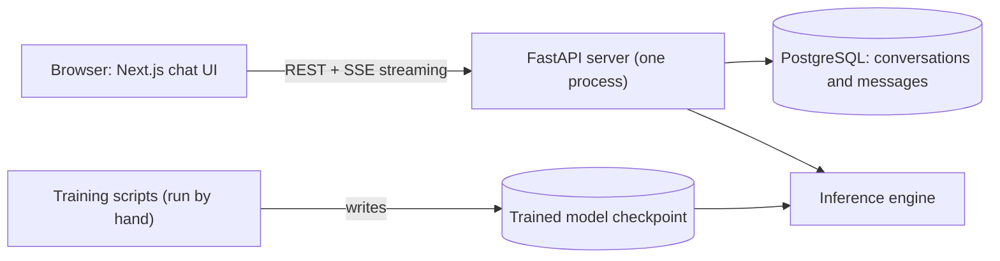

# brainX

**A public, ChatGPT-style portfolio chatbot powered by a small language model trained from scratch.**


brainX is a student portfolio project with one goal: to understand how a language model works by building every part of one. That means the tokenizer, the Transformer, the training loop, the inference engine, the API, and the chat interface. No hosted AI service and no pre-trained weights are used anywhere.

> **Project status: planning.** The documentation, task plan, and agent tooling are written. The application and the model are **not built yet**, so there is nothing to run. See [Status](#status) for exactly where the work stands.

## Contents

- [Why this project](#why-this-project)
- [Planned features](#planned-features)
- [How it fits together](#how-it-fits-together)
- [The model](#the-model)
- [Tech stack](#tech-stack)
- [Repository layout](#repository-layout)
- [Status](#status)
- [Getting started](#getting-started)
- [Documentation](#documentation)
- [Limitations](#limitations)
- [Data and licences](#data-and-licences)
- [Built with AI agents](#built-with-ai-agents)
- [References](#references)
- [Author and licence](#author-and-licence)

## Why this project

Most chatbot projects call an API. This one does the opposite: it builds the model itself, on hardware a student can own, and keeps everything local.

- **Learn by building.** Each stage (data, tokenizer, model, training, evaluation, serving) is written by hand and tested.
- **Stay honest.** Every number in the project comes from a real run. The model will be small and often wrong, and the project says so.
- **Work like a professional.** Documented decisions, small reviewable tasks, tests, and a written workflow.

## Planned features

The MVP is text only.

- Streaming replies, token by token.
- A Stop button that keeps the partial reply.
- Multi-turn conversations, with earlier messages sent as context.
- Saved conversation history in PostgreSQL: reopen or delete earlier chats.
- Email-and-password registration, login, logout, and private per-user conversation history.
- Markdown replies with syntax-highlighted code blocks and a copy button.
- A settings panel for temperature, top-k, top-p, and reply length.
- Light and dark themes, keyboard shortcuts, and a responsive layout.
- A Minimalist + Neo-Brutalist design ([DESIGN.md](docs/DESIGN.md)).

Out of scope: payments, images, voice, file upload, web search, email verification, and password reset.

## How it fits together



- **Monorepo** (Turborepo): one repository for the frontend, backend, and model code.
- **Modular monolith**: one backend process with clear internal modules. No microservices.
- **Training is separate**: it runs from the terminal and never inside the server.

Details: [ARCHITECTURE.md](docs/ARCHITECTURE.md), [BACKEND.md](docs/BACKEND.md), [FRONTEND.md](docs/FRONTEND.md).

## The model

| | |
|---|---|
| Approach | Decoder-only Transformer (GPT-style), trained from scratch in PyTorch |
| Tokenizer | Byte-level BPE, written in this repo, 8,000 tokens |
| Planned size | 17,437,440 parameters, 512-token context |
| Training stages | Pre-train on plain English text, then instruction-tune the same weights |
| Hardware | Apple M4, 16 GB, training on the Mac's GPU (PyTorch MPS), reply generation on CPU |
| Language | English only |

**No training has run yet, so there are no model results.** The size above is a recommendation that the owner confirms in task P2-T2. In a 40-second test on random data, the M4 trained this size at about 12,300 tokens per second. That speed is a rough estimate, not a result for the real data.

Details: [MODEL.md](docs/MODEL.md).

## Tech stack

| Part | Technology |
|---|---|
| Monorepo | Turborepo, pnpm |
| Frontend | Next.js, React, TypeScript (strict), Tailwind CSS 4, Radix UI, shared design system |
| Backend | Python, FastAPI, SQLAlchemy, Alembic, PostgreSQL |
| Model | PyTorch |
| Python tooling | uv, pytest, Ruff, mypy |
| Testing | pytest, Vitest, Playwright |

Packages are added only in the task that needs them. Versions and reasons are in the package tables of [MODEL.md](docs/MODEL.md#packages), [BACKEND.md](docs/BACKEND.md#packages), and [FRONTEND.md](docs/FRONTEND.md#packages).

## Repository layout

```text
apps/
  web/            Next.js app (starter now; becomes the chat UI)
  admin/          Admin area, same design system as web (pages are placeholders)
  api/            FastAPI server (planned)
packages/
  eslint-config/  Shared lint settings
  typescript-config/  Shared TypeScript settings
  ui/             Shared design system: tokens and components used by web and admin
model/            Notebooks, source, configs, tests (empty placeholders so far)
docs/             Project documentation
.claude/          Helpers for Claude Code: skills, subagents, and a safety hook
```

## Status

The plan has 8 phases and 79 small tasks. Phase 1 is in progress.

| Phase | Focus | Tasks | Status |
|---|---|:-:|---|
| 1 | Planning and setup | 6 | In progress (3 done, 1 partly) |
| 2 | Dataset and tokenizer | 10 | Not started |
| 3 | Model and training | 11 | Not started |
| 4 | Evaluation and local inference | 8 | Not started |
| 5 | Backend | 20 | Not started |
| 6 | Frontend | 16 | Not started |
| 7 | Integration | 3 | Not started |
| 8 | Final testing and demo | 5 | Not started |

The model comes first: backend and frontend work starts only after a trained model generates text locally with no external API. Live status: [PROGRESS.md](docs/PROGRESS.md). All tasks: [TASKS.md](docs/TASKS.md).

## Getting started

There is nothing to run yet. The setup and run commands will be written as the tasks that create them are finished, and the final version is task P8-T4.

**Requirements** (checked on the author's Mac on 2026-11-02):

| Tool | Version |
|---|---|
| Mac | Apple M4, 16 GB RAM |
| Node.js | 26.13.0 (the repo requires 24 or newer) |
| pnpm | 11.25.0 |
| Python | 3.13, managed by uv |
| uv | 0.12.15 |
| PostgreSQL | 18 (the installed binary reports 18.6) |
| Docker | Optional |

**To see the UI today:** run `pnpm dev` (Turborepo starts both apps). Open `http://localhost:3000` for the chat preview and `http://localhost:3001` for the admin area, where `/design` shows every colour and component. Both are static previews, not connected to a model yet.

**To follow the project today:**

1. Read [PROJECT.md](docs/PROJECT.md) for the goals and scope.
2. Read [TASKS.md](docs/TASKS.md) for the order of work.
3. To work on it with Claude Code, read [GUIDE.md](docs/GUIDE.md) (written in Bengali for the author), then run `/brainx-task P1-T4`.

## Documentation

| File | Contents |
|---|---|
| [PROJECT.md](docs/PROJECT.md) | Goals, decisions, MVP scope, and an acceptance map |
| [ARCHITECTURE.md](docs/ARCHITECTURE.md) | System design, folders, and key decisions |
| [MODEL.md](docs/MODEL.md) | Data, tokenizer, model, training, evaluation, and its tasks |
| [BACKEND.md](docs/BACKEND.md) | API, database, backend packages, and its tasks |
| [FRONTEND.md](docs/FRONTEND.md) | Frontend packages, structure, and its tasks |
| [DESIGN.md](docs/DESIGN.md) | The visual and interaction rules |
| [TASKS.md](docs/TASKS.md) | Every phase and task |
| [PROGRESS.md](docs/PROGRESS.md) | Current status and open problems |
| [GUIDE.md](docs/GUIDE.md) | Student guide to working with the agent |
| [DOCUMENTATION_AUDIT.md](docs/DOCUMENTATION_AUDIT.md) | A review of how complete the documentation is |

## Limitations

A model this small will not behave like ChatGPT or Claude.

- **Likely:** simple English sentences and replies in the right format.
- **Often wrong:** facts. A small model remembers little and cannot look anything up.
- **Not expected:** maths, code, or long reasoning.
- **Short memory:** the context window is 512 tokens, so long conversations are forgotten.
- **No safety training:** it can repeat problems found in its training data.

The interface will say that its answers can be wrong.

## Data and licences

The planned training data is public. The licence tags below are what each dataset page declared on 2026-11-02, and task P2-T3 confirms them before anything is downloaded.

| Dataset | Used for | Licence tag |
|---|---|---|
| [TinyStories](https://huggingface.co/datasets/roneneldan/TinyStories) | Simple English, pre-training | CDLA-Sharing-1.0 |
| [Simple English Wikipedia](https://huggingface.co/datasets/wikimedia/wikipedia) | Factual text, pre-training | CC-BY-SA-3.0, GFDL |
| [Dolly 15k](https://huggingface.co/datasets/databricks/databricks-dolly-15k) | Instruction tuning | CC-BY-SA-3.0 |
| [OpenAssistant (OASST1)](https://huggingface.co/datasets/OpenAssistant/oasst1) | Conversations | Apache-2.0 |

Note that TinyStories was written by GPT-3.5 and GPT-4. This project calls no AI service and loads no pre-trained model, but the text it learns from is partly machine-generated. Several datasets are share-alike, so the trained weights stay private unless a licence review says otherwise.

## Built with AI agents

brainX is built by a student working with AI coding agents (Claude Code), one small task at a time. The rules are written down in [AGENTS.md](AGENTS.md): explain first, wait for approval, change only the approved files, run the checks, report only real results, then stop. The author reviews every change and decides what is committed. Helpers for Claude Code live in `.claude/`: seven skills, two read-only subagents, and a hook that asks before risky commands. They are not yet verified inside Claude Code; see [PROGRESS.md](docs/PROGRESS.md).

## References

- Eldan and Li, [TinyStories: How Small Can Language Models Be and Still Speak Coherent English?](https://arxiv.org/abs/2305.07759), 2023.

## Author and licence

Built by Abdur Rahman ([GitHub](https://github.com/abdurrahmanse)).

No licence has been chosen yet, so by default all rights are reserved. The datasets above keep their own licences.
