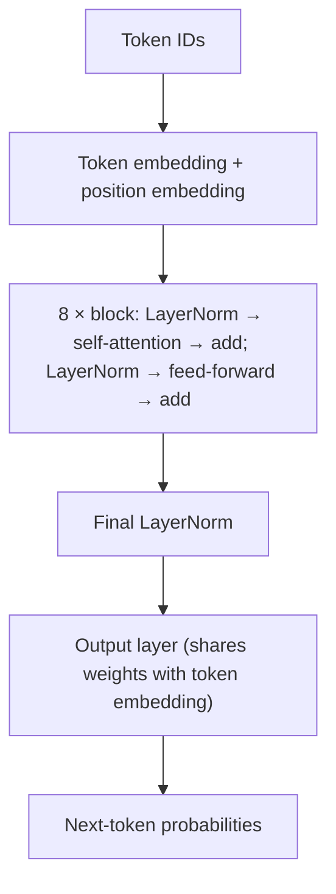

# brainX: AI Model Specification

**Status:** Proposed, awaiting owner approval. **Last updated:** 2026-11-02.

Every model in this project starts from random weights and is trained on the owner's Mac. No pre-trained weights are used at any stage (constraints C1-C4 in [PRD.md](PRD.md)).

## The pipeline at a glance


**Why two training stages?** Pre-training teaches language from lots of plain text. Fine-tuning then uses a much smaller instruction dataset to teach a behaviour: when a user asks something, respond and then stop. Those instruction datasets are too small to teach English on their own.

## Facts, estimates, and unknowns

| Kind | Examples | Where they come from |
|---|---|---|
| **Measured** | Benchmark speeds, dataset row counts | Commands run on 2026-11-02; caveats below |
| **Derived** | Parameter counts, tokens per hour | Arithmetic on measured values |
| **Starting values** | Learning rate, batch size | Conventional choices, to be tested |
| **Unknown** | Final loss, answer quality, total tokens in each dataset, real training duration | Only real runs can tell |

No training has been run yet, so this document contains no model results.

## Measured on this Mac

A throwaway script trained a GPT-style model with the architecture described below, on an M4 with 16 GB, Python 3.13.15, and PyTorch 2.15.0. It was run for 40 seconds per size.

| Config | Context | Dim | Layers | Heads | Parameters | Weights (float32) | Batch | Train speed (MPS) | MPS memory reading |
|---|---:|---:|---:|---:|---:|---:|---:|---:|---:|
| S | 256 | 256 | 6 | 8 | 6,838,784 | 27 MB | 32 | 26,524 tokens/s | 3.38 GB |
| **M (chosen)** | 512 | 384 | 8 | 8 | 17,437,440 | 70 MB | 16 | 12,332 tokens/s | 5.46 GB |
| L | 512 | 512 | 10 | 8 | 35,836,928 | 143 MB | 16 | 7,101 tokens/s | 6.57 GB |

All three use a vocabulary of 8,000 tokens.

| Config | Generate on CPU | Generate on MPS | Tokens per hour (derived) | Tokens in 8 hours (derived) |
|---|---:|---:|---:|---:|
| S | 1,049 tokens/s | 58 tokens/s | 95.5M | 764M |
| **M** | 509 tokens/s | 175 tokens/s | 44.4M | 355M |
| L | 302 tokens/s | 279 tokens/s | 25.6M | 205M |

**How far to trust these numbers:**

- They used random tokens and random weights with a single short run, so there's no data loading, dropout, evaluation, or checkpoint overhead.
- A 40-second run can't reveal slowdown from sustained heat, so an overnight run may be slower.
- Other apps were not closed, and the Mac's load was not controlled.
- The memory figure is the driver's allocation at one moment, in a process that had already run earlier configs. Treat it as a rough guide, not a peak.
- The S result of 58 tokens/s on MPS looks wrong, since it is slower than larger models. It ran first, so MPS warm-up is a likely cause, but this was not confirmed.
- Generation is a single stream with a KV cache, measured over 150 tokens.

Phase 5 re-measures training speed on real data. Phase 7 re-measures generation.

### Why config M

- **S** is used as a fast smoke test but leaves less room for two very different data sources.
- **M** leaves room for other apps in 16 GB and gets about 355M tokens through an overnight run.
- **L** is the upgrade path if M underfits, but an overnight run gets through about 42% fewer tokens.

The TinyStories paper reports that models under 10M parameters can write fluent text within that dataset's simple domain, which supports the feasibility of this size range. It does not imply general knowledge.

For a sense of scale, SmolLM2-135M's model card lists about 2 trillion pre-training tokens. An 8-hour run on config M is about 0.02% of that, in a model about 8 times smaller. It is cited for scale only, and the model isn't used here. This gap is why the expectations in [PRD.md](PRD.md#expected-quality) are modest.

## Datasets

Facts below were retrieved from Hugging Face on 2026-11-02. A licence tag is what the dataset page declares. It is not legal advice.

### Pre-training

| Dataset | Rows | Parquet size | Licence tag | Why |
|---|---:|---:|---|---|
| `roneneldan/TinyStories` | 2,141,709 | 1.0 GB | CDLA-Sharing-1.0 | Simple, consistent English a small model can learn |
| `rahular/simple-wikipedia` | 769,764 | 87 MB | **No licence tag** | Factual vocabulary, which TinyStories lacks |

- **TinyStories** text was generated by GPT-3.5 and GPT-4. The project doesn't call those models, but the owner should accept this knowingly (decision D1).
- **Simple Wikipedia:** Phase 2 must confirm the licence before use. If it can't be confirmed, use a Simple English build from `wikimedia/wikipedia` (tagged CC-BY-SA-3.0 and GFDL), after confirming that build is available. Rows are short fragments (median 208 characters across the first 50,000 rows), and the first row is only the title "April", so cleaning matters.

**Mix:** start at 50% from each by token count. Because stories are much more uniform, this stops them dominating the model's vocabulary. The mix is a starting value that Phase 5 can change.

### Instruction fine-tuning

| Dataset | Rows | Licence tag | Written by | Use |
|---|---:|---|---|---|
| `databricks/databricks-dolly-15k` | 15,011 | CC-BY-SA-3.0 | People | Questions and instructions (median reply: 186 characters) |
| `OpenAssistant/oasst1` | 84,437 train + 4,401 validation | Apache-2.0 | Mostly people | Conversations |

- **Dolly categories include:** `open_qa` 3,742, `general_qa` 2,191, `classification` 2,136, `closed_qa` 1,773, `brainstorming` 1,766, `information_extraction` 1,506, `summarization` 1,188, `creative_writing` 709.
- **OASST1 train split** has 39,283 English messages (15,200 from people asking and 24,083 replies) across 3,482 English conversation starters. Each row is one message in a tree, not a whole conversation.

**Filter OASST1 to:** `lang = en`, not `deleted`, `review_result` true, `synthetic` false. Reconstruct each conversation by following the best-ranked reply path.

This data is small, so overfitting is the main fine-tuning risk. Conversation data is especially limited. Phase 2 reports the exact count after filtering.

### Considered and excluded

| Dataset | Reason |
|---|---|
| `li2017dailydialog/daily_dialog`, `HuggingFaceH4/no_robots` | Non-commercial licence tags restrict future options |
| `allenai/soda` (1,486,896 rows, CC-BY-4.0) | Good candidate if conversation quality is weak, but it is another machine-generated set. Kept in reserve |
| `HuggingFaceH4/ultrachat_200k` | Machine-generated, so it raises the same question as D1 without adding human-written conversations |
| `rajpurkar/squad` | Answers are extracted from a passage the model wouldn't have in chat |

### Processing rules

1. Normalise Unicode to NFC and whitespace to single spaces within lines.
2. Remove empty, title-only, and very short rows. Thresholds are chosen after looking at the data and recorded in the config.
3. Remove exact duplicates using a hash of normalised text.
4. Split deterministically by hash into train, validation, and test, so splits never change on re-run and duplicates can't cross splits.
5. Write a `manifest.json` with source revision, licence tag, row counts before and after each step, and output hashes.

## Tokenizer

**Decision:** project-written byte-level BPE (decision D3). The tokenizer has 8,000 tokens.

**How it works:** text begins as UTF-8 bytes (256 starting tokens). Training repeatedly finds the most common adjacent pair across the corpus, and merges it into a new token until the vocabulary is full. Encoding applies those merges in the same order.

| Choice | Why |
|---|---|
| Byte-level start | Any text encodes and decodes exactly, so no "unknown" token is needed |
| Pre-split on words, numbers, punctuation, and spaces | Merges stay within sensible word pieces, and training is faster |
| 8,000 tokens | Enough for simple English, while a smaller embedding table leaves more parameters for the Transformer. It can be tuned in Phase 3 |
| Sample for training | Pure Python is slow, so start from a sample of about 50 MB drawn from all four datasets |
| Word-level encoding cache | Common words repeat, so caching should greatly reduce encoding time |

**Special tokens**, reserved from the start because the vocabulary can't change after pre-training begins:

`<|pad|>` `<|bos|>` `<|eos|>` `<|user|>` `<|assistant|>` `<|end|>`

**Chat format**, in one function, `format_chat()`, used by both training and serving so they can't drift apart:

```text
<|bos|><|user|>What is rain?<|end|><|assistant|>Rain is water that falls from clouds.<|end|>
```

**Streaming detail:** one token can end partway through a multi-byte character, so the decoder holds back incomplete bytes until the character is complete. A test covers this with emoji and accented text.

**Unknown until Phase 3:** how long the Python trainer takes. If it's impractical, reduce the sample size first. Replacing it with a library needs owner approval because of C4.

## Model architecture

A decoder-only Transformer in the GPT-2 style, hand-written in PyTorch.



| Setting | Config M | Why |
|---|---|---|
| Vocabulary | 8,000 | See above |
| Context length | 512 tokens | Room for a short conversation |
| Embedding dimension | 384 | With layers, sets model capacity |
| Layers / heads | 8 / 8 | Conventional ratio; 48 dimensions per head |
| Feed-forward size | 1,536 (4×) | GPT-2's convention |
| Activation | GELU | GPT-2's convention |
| Normalisation | LayerNorm before each sub-layer | Trains more stably in deep networks |
| Positions | Learned embeddings | Simplest to understand, but the context limit is hard |
| Weight tying | Output shares with token embedding | Saves 3M parameters and is a well-established technique |
| Attention | Causal, using `scaled_dot_product_attention` | PyTorch's optimised routine for the same formula |
| Linear layer bias | None | Slightly fewer parameters |
| Dropout | 0.1 (off at inference) | Light regularisation |
| Initialisation | Normal, std 0.02, scaled down on residual layers | GPT-2's scheme, which keeps early training stable |

RoPE, RMSNorm, and SwiGLU are used by newer models. They were left out because they would be extra concepts with little known benefit at this scale. They could be good learning experiments later.

Writing out the attention maths once as a learning step is worthwhile, and a test checks that it matches PyTorch's routine.

## Training

### Pre-training starting values

| Setting | Value |
|---|---|
| Device / precision | MPS / float32 |
| Batch | 16 random windows of 512 tokens |
| Optimiser | AdamW, weight decay 0.1 (not on norms or embeddings) |
| Learning rate | 3e-4 peak, linear warm-up for the first 2% of steps, then cosine decay |
| Gradient clipping | 1.0 |
| Budget | About 355M tokens is about 8 hours, if the benchmark speed holds |

### Fine-tuning starting values

| Setting | Value |
|---|---|
| Starts from | Best pre-training checkpoint |
| Trainable | All layers. LoRA adds complexity without a benefit at this size |
| Learning rate | 5e-5 peak, about 6 times below pre-training, so training refines the model rather than overwriting it |
| Loss | Assistant tokens and their `<\|end\|>` only, since the model doesn't need to learn to write the user's turn |
| Examples | Examples longer than 512 tokens are dropped, and their count is reported |
| Stopping | Stop when validation loss stops improving |

### Checkpoints and resuming

- Save every N steps with weights, optimiser, scheduler, step, random states, and configs.
- Save to a temporary file, then rename, so a crash can't corrupt the latest checkpoint.
- Keep `latest` and `best` (lowest validation loss), and periodic ones only if disk use is acceptable.
- Stop the run immediately if the loss becomes NaN.
- Prevent the Mac from sleeping during long runs: `caffeinate -i <training command>`.

### Reproducibility

Each run gets a folder under `artifacts/runs/<timestamp>-<name>/` with:

- `config.json`: full model and training config.
- `manifest.json`: git commit, seed, dataset and tokenizer hashes, and library versions.
- `metrics.jsonl`: step, training and validation loss, learning rate, tokens/s.
- `samples.jsonl`: fixed-prompt outputs at each evaluation.

Seeds are fixed, but PyTorch doesn't guarantee identical results on MPS. "Reproducible" here means same code, data, and config, and similar results, not identical weights.

## Evaluation

| Check | Stage | What it tells you | Pass rule |
|---|---|---|---|
| Initial loss ≈ ln(8000) ≈ 8.99 | Before training | Model starts as uniformly unsure, as it should | Close to 8.99 |
| Overfit one small batch | Before training | Model and training loop can learn | Loss near zero |
| **Bigram baseline** | Phase 5 | A simple counting model gives the score to beat | Must beat its validation loss |
| Validation loss and perplexity | Phases 5-6 | Learning without just memorising | Falls, then flattens |
| Fixed-prompt suite | Phases 5-7 | Does it actually respond usefully? | Set after first run |
| Pre-trained vs fine-tuned | Phase 6 | Whether fine-tuning helped | Fine-tuned scores higher on the suite |

**Fixed-prompt suite** in `eval/prompts.jsonl`, written before training starts, and not drawn from the training data:

| Category | Count | Automatic score | Human review |
|---|---:|---|---|
| Text generation | 15 | Stops cleanly; repetition rate | Coherence, 0-2 |
| Basic questions | 20 | Answer contains an accepted keyword | Correctness, 0-2 |
| Conversation | 15 | Stops cleanly; refers to the earlier turn | Relevance, 0-2 |

Rules that keep the result honest:

- Use the same prompts, seed, and generation settings for every candidate.
- Save raw outputs next to scores, so any number can be checked.
- Freeze pass thresholds after the first real result and before the final run. Record them in the report. Do not lower them afterwards without stating so.
- The test split is used once, to report loss for the final selected checkpoint. It is never used for tuning or selection.

## Inference

| Setting | Starting value | Effect |
|---|---|---|
| Device | CPU (ADR-006) | Fastest measured for config M |
| Temperature | 0.8 | Below 1 favours likelier words |
| Top-k / top-p | 40 / 0.95 | Limits choices to likely tokens |
| Repetition penalty | 1.1 | Small models tend to loop |
| Max new tokens | 200 | Keeps replies short |

Users can override temperature, top-k, top-p, and max new tokens per message, within the [API limits](ARCHITECTURE.md#generation-settings). **Evaluation always uses the frozen defaults**, so scores stay comparable.
| Stop | `<\|end\|>` or `<\|eos\|>` | The learned end of a reply |

These are tuned in Phase 7 using the fixed prompts, then frozen before the final scores are recorded.

**Context handling:** the context limit is a hard 512 tokens, and `max_new_tokens` is reserved for the reply. The default of 200 leaves 312 for the prompt, while the maximum of 300 leaves 212, so longer replies mean less remembered conversation. The engine keeps the newest whole messages that fit, and drops older ones. If the newest message alone is too long, keep its end. The model truly forgets anything dropped, and the UI's stored history doesn't change.

**KV cache:** this keeps earlier attention results, so each new token doesn't reprocess the whole prompt. A test checks that cached and uncached generation produce the same logits.

**Optimisation:** none planned. Generation already runs at hundreds of tokens per second in the benchmark. Quantization is not in the MVP, and should only be considered if Phase 7's real measurement shows a problem.

## Limitations

The model will invent facts confidently, since it stores little knowledge and has no way to look anything up. It will also have:

- Limited context, so long conversations are forgotten.
- Weak or absent ability in maths, code, and multi-step reasoning.
- Knowledge limited to what its training data contains, with a bias toward the simple style of children's stories.
- No safety training, so it can repeat problems found in its data. OASST1 has `detoxify` scores, which could be used for filtering, and Phase 2 reports what they show.

## Experiments if results are weak

Try these in order, changing one thing at a time. Each is a separate approved task:

1. Train longer on M.
2. Improve data cleaning and the data mix.
3. Add a reserved dataset such as SODA for conversation.
4. Train config L.

Pre-trained models are not on this list (C2).

## References

- Eldan & Li, [TinyStories](https://arxiv.org/abs/2305.07759), 2023.
- Hugging Face, [SmolLM2-135M model card](https://huggingface.co/HuggingFaceTB/SmolLM2-135M-Instruct), cited for scale only. The 2T figure came through a search summary and should be re-checked before being quoted elsewhere.
- Dataset pages on [Hugging Face](https://huggingface.co/datasets) as named above.
