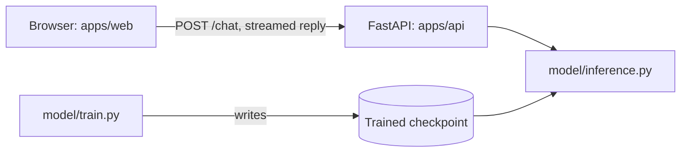

# brainX: Architecture

This is the planned design. Folders marked "planned" do not exist yet.

## Overview



- **Monorepo:** one repository holds the frontend, backend, and model code.
- **Modular monolith:** there is one backend server, and its code is split into clear parts.
- **Training:** a command you run by hand. It never runs inside the server.

## Folders

```text
apps/web/             Next.js chat UI (exists as a starter; see FRONTEND.md)
apps/api/             FastAPI server (planned)
  main.py             routes and server startup
model/                model code (planned)
  data/               downloaded and processed data, not in git
  checkpoints/        trained weights, not in git
  prepare_data.py     download, clean, and split data
  tokenizer.py        our BPE tokenizer
  gpt.py              the Transformer
  train.py            pre-training and fine-tuning
  evaluate.py         loss and fixed-prompt tests
  inference.py        load a checkpoint and generate text
  tests/              model tests
packages/             shared ESLint and TypeScript settings (exist)
docs/                 project documentation
pyproject.toml        Python dependencies (planned)
package.json          JavaScript workspace (exists)
turbo.json            Turborepo tasks (exists)
```

`apps/docs` and `packages/ui` came with the starter and are not needed. P1-T4 asks before removing them.

**Python setup:** one `pyproject.toml` at the repo root, with Python commands run from the root. `apps/api` can then use `from model.inference import ...`. This simple layout is untested, so P1-T6 must prove it works.

## Who can use what

| Code | May use | Must not use |
|---|---|---|
| `apps/web` | `apps/api` over HTTP | Any Python code |
| `apps/api` | `model/inference.py` | `train.py`, `prepare_data.py`, `evaluate.py` |
| `model/inference.py` | `gpt.py`, `tokenizer.py` | `apps/api` |
| `model/train.py` | `gpt.py`, `tokenizer.py` | `apps/api` |

## API

The server runs at `http://127.0.0.1:8000`. It stores nothing, so the browser keeps conversations and sends the current one with each message.

### `GET /health`

```json
{
  "status": "ok",
  "model_loaded": true,
  "generation": {
    "defaults": { "temperature": 0.8, "top_k": 40, "top_p": 0.95, "max_new_tokens": 200 },
    "limits": {
      "temperature": [0.0, 2.0],
      "top_k": [1, 200],
      "top_p": [0.1, 1.0],
      "max_new_tokens": [1, 300]
    }
  }
}
```

### `POST /chat`

Request:

```json
{
  "messages": [
    { "role": "user", "content": "What is rain?" },
    { "role": "assistant", "content": "Rain is water from clouds." },
    { "role": "user", "content": "Why does it fall?" }
  ],
  "generation": { "temperature": 0.8, "max_new_tokens": 200 }
}
```

`generation` is optional, and any missing field uses the default. Values outside the limits return `422`.

The reply uses Server-Sent Events (SSE), which send small pieces of text as they are ready:

```text
event: delta
data: {"text":"Rain"}

event: done
data: {"finish_reason":"stop"}

event: error
data: {"message":"Generation failed"}
```

**Stopping a reply:** the browser aborts the request, and the server stops generating when it notices the disconnect. P5-T7 must prove this with the installed FastAPI version.

Errors before streaming starts:

| Status | Meaning |
|---|---|
| 409 | The model is already generating a reply |
| 422 | The request is invalid |
| 503 | No trained model is loaded |

## Key decisions

| Decision | Why |
|---|---|
| Generate replies inside the API process | One server is simpler, and a separate one would add complexity with little benefit here |
| One reply at a time | There is one user, so no queue is needed |
| Browser calls FastAPI directly | Avoids a proxy that might buffer the stream |
| Browser stores conversations (recommendation) | Keeps the server simple and needs no database. P6-T12 asks for confirmation |
| Python `.py` files in `model/` | Easier to read and learn from than a larger package structure |

## Tools and versions

Checked on 2026-11-02. "Tested" means it ran in a temporary test outside this repo.

| Tool | Version | Status |
|---|---|---|
| Node.js | 26.13.0 | Installed on the Mac |
| pnpm | 11.25.0 | In the repo |
| Turborepo | 2.11.10 | In the repo |
| Next.js / React | 16.3.8 / 19.2.8 | In the repo; build is unconfirmed, see P1-T3 |
| TypeScript | 7.0.2 | In the repo; passed a build with Next.js 16.4.3 |
| Tailwind CSS | 4.3.3 | Added in Phase 6; other frontend packages are in [FRONTEND.md](FRONTEND.md) |
| Python / uv | 3.13.15 / 0.12.15 | Tested |
| PyTorch | 2.15.0 | Tested; Apple GPU (MPS) available |
| FastAPI / Uvicorn | 0.162.0 / 0.54.0 | Installed in a test; FastAPI includes SSE support |
| datasets | 5.1.0 | Installed in a test; used only to download data |
| pytest | 9.2.0 | Tested |

Add a dependency only when a task needs it and the owner approves it.

## Security and privacy

- The server listens only on `127.0.0.1`. There is no login, so it must not be exposed to a network.
- CORS allows only `http://localhost:3000`.
- Model output is untrusted. Markdown rendering keeps raw HTML disabled, links aren't clickable, and P6-T8 and P6-T9 test this with script tags.
- Checkpoints load with `torch.load(weights_only=True)`.
- Data, checkpoints, and `.env` files stay out of git.
