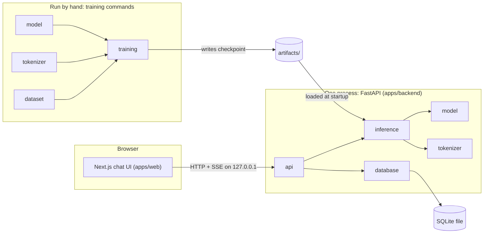
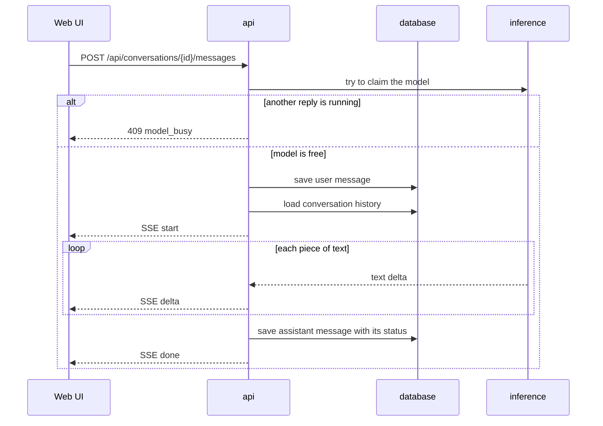
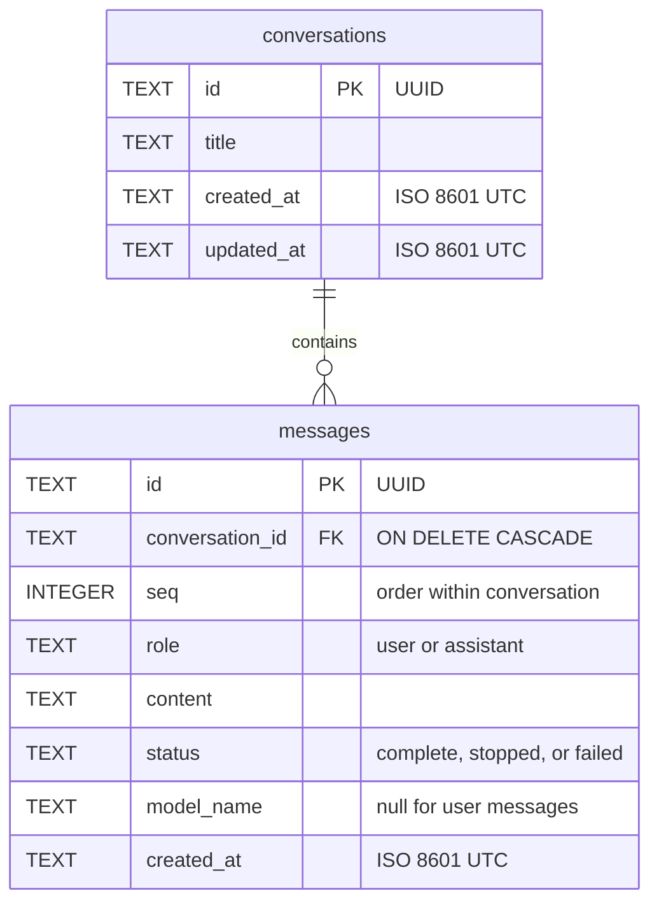

# brainX: Architecture

**Status:** Proposed, awaiting owner approval. **Last updated:** 2026-11-02.

Requirements are in [PRD.md](PRD.md), tool versions in [TECH_STACK.md](TECH_STACK.md), and ML details in [AI_MODEL.md](AI_MODEL.md).

## Overview

Three separate ideas are easy to confuse:

| Idea | What it means here |
|---|---|
| **Monorepo** (Turborepo) | One repository holding the frontend and backend. It concerns how code is stored and tasks are run. |
| **Modular monolith** | The whole backend is **one Python package and one server process**, divided into modules with enforced import rules. |
| **Separate runs** | Training is a command you run by hand. It shares code with the server but never runs inside it. |



The `model` and `tokenizer` boxes appear twice because the same code is used in both situations. There is only one copy of each module.

## Repository structure

`create-turbo` generated the starter, which is committed. **Keep** means used as is, while **Add**, **Change**, and **Remove** happen in the listed phase. None of them has been done yet.

```text
brainX/
├── apps/
│   ├── web/                  # Change, Phase 9: starter page becomes the chat UI
│   │   ├── app/              #   Next.js routes and layout
│   │   ├── components/       #   chat UI components
│   │   └── lib/              #   API client and SSE parser
│   ├── docs/                 # Remove, Phase 1 (decision D2): unused starter app
│   └── backend/              # Add, Phase 1
│       ├── package.json      #   makes Turborepo see it; scripts call uv
│       ├── pyproject.toml    #   Python dependencies
│       ├── uv.lock
│       ├── .python-version
│       ├── configs/          #   model and training JSON configs
│       ├── eval/             #   fixed evaluation prompts
│       ├── src/brainx/
│       │   ├── tokenizer/    #   Phase 3
│       │   ├── dataset/      #   Phases 2-3
│       │   ├── model/        #   Phase 4
│       │   ├── training/     #   Phases 5-6
│       │   ├── inference/    #   Phase 7
│       │   ├── database/     #   Phase 8
│       │   ├── api/          #   Phase 8
│       │   └── config.py     #   Phase 8: server settings
│       ├── tests/            #   mirrors src/brainx/ module names
│       ├── data/             #   gitignored: downloaded and processed data
│       ├── artifacts/        #   gitignored: tokenizers and checkpoints
│       └── var/              #   gitignored: SQLite database
├── packages/
│   ├── eslint-config/        # Keep
│   ├── typescript-config/    # Keep
│   └── ui/                   # Remove, Phase 1 (decision D2): one app needs no shared UI package
├── docs/                     # These documents
├── AGENTS.md                 # Change, Phase 1: keep Turborepo's managed block, add a pointer to the rules
├── CLAUDE.md                 # Add, Phase 1: points to the rules
├── README.md                 # Change, Phase 1: expand the one-line README
├── package.json              # Change, Phase 1: rename from my-turborepo
├── pnpm-workspace.yaml       # Keep
└── turbo.json                # Change, Phase 1: add test task
```

## Backend modules

Each brief-required module maps to one folder.

| Module | Responsibility | Public interface (planned) | May import |
|---|---|---|---|
| `tokenizer` | Train BPE, encode/decode, chat format | `Tokenizer`, `format_chat()` | Python stdlib |
| `model` | Transformer, sampling, weight loading | `GPT`, `ModelConfig`, `sample_stream()`, `load_weights()` | PyTorch |
| `dataset` | Download, clean, split, tokenize, batch | CLI commands, `TokenBatches`, `InstructionBatches` | `tokenizer`, numpy, datasets, PyTorch |
| `training` | Pre-train, fine-tune, checkpoints, evaluation | CLI commands | `model`, `tokenizer`, `dataset` |
| `inference` | Load a model once, build prompts, stream a reply | `InferenceEngine` | `model`, `tokenizer` |
| `database` | Migrations and SQL for conversations and messages | `ConversationStore` | Python stdlib |
| `api` | HTTP routes, schemas, errors, app startup | FastAPI `app` | `inference`, `database`, `config` |
| `config` | Server settings from the environment | `Settings` | pydantic-settings |

**Enforced rules**, checked by `import-linter` in the test run:

- `inference` and `api` must never import `training` or `dataset`. The server therefore does not depend on training code.
- `tokenizer`, `model`, and `database` must not import any other project module.
- `database` and `inference` must not import `api` or each other. Only `api` connects them.
- A module's outside users import only from that module's `__init__.py`.

**Frontend:** `apps/web` is the frontend module. It talks to the backend only through the HTTP contract below and shares no code with Python.

**Why Turborepo at all, with only one TypeScript app?** The brief requires it, and it gives one command for lint, type-check, and test across both languages.

## Chat request flow



If the user presses Stop, the browser aborts the request. The server detects the disconnect, stops generating at the next token, and saves the partial reply with status `stopped`.

Phase 8 starts with a spike to confirm this disconnect behaviour with the installed FastAPI version, because the plan depends on it.

## API contract

Base URL is `http://127.0.0.1:8000/api`, and all bodies are JSON unless stated. Message and title limits are enforced by the API.

| Method and path | Purpose | Success |
|---|---|---|
| `GET /health` | Server and model status, plus generation defaults and limits | `200 { status, model: { loaded, name, device }, generation: { defaults, limits } }` |
| `GET /conversations` | List, newest first | `200 Conversation[]` |
| `POST /conversations` | Create empty conversation | `201 Conversation` |
| `GET /conversations/{id}` | Conversation with messages | `200 ConversationDetail` |
| `PATCH /conversations/{id}` | Rename: `{ title }`, 1-200 characters | `200 Conversation` |
| `DELETE /conversations/{id}` | Delete with its messages | `204` |
| `POST /conversations/{id}/messages` | Send: `{ content, generation? }`, with `content` 1-4000 characters | `200` SSE stream |

```text
Conversation        { id, title, created_at, updated_at }
ConversationDetail  Conversation + { messages: Message[] }
Message             { id, seq, role, content, status, model_name, created_at }
```

### Generation settings

`generation` is optional, and any field left out uses the server default. Out-of-range values return `422 invalid_request`. The API is the only authority on limits: it publishes them through `GET /health`, so the UI doesn't keep its own copy.

| Field | Default | Allowed range |
|---|---:|---:|
| `temperature` | 0.8 | 0.0-2.0, where 0.0 always picks the likeliest token |
| `top_k` | 40 | 1-200 |
| `top_p` | 0.95 | 0.1-1.0 |
| `max_new_tokens` | 200 | 1-300 |

Defaults are starting values, and Phase 7 may change them. Repetition penalty stays fixed in the MVP. The browser stores the chosen settings in `localStorage` and sends them with each message, so no settings table is needed.

### Stream events

```text
event: start
data: {"user_message_id":"...","assistant_message_id":"..."}

event: delta
data: {"text":"Hello"}

event: done
data: {"finish_reason":"stop","generated_tokens":42}

event: error
data: {"code":"generation_failed","message":"..."}
```

`finish_reason` is `stop` (the model ended its reply) or `length` (the token limit was reached). A stopped reply has no `done` event, because the client has already disconnected.

### Errors

Every error before streaming starts uses one shape: `{ "error": { "code", "message" } }`.

| Status | Code | When |
|---|---|---|
| 404 | `conversation_not_found` | Unknown ID |
| 409 | `model_busy` | One reply is already generating |
| 422 | `invalid_request` | Failed validation |
| 503 | `model_unavailable` | No usable checkpoint is loaded |
| 500 | `internal_error` | Anything unexpected; details are logged and not sent |

## Database

SQLite with Python's built-in `sqlite3`, stored in `apps/backend/var/brainx.db`.



- `UNIQUE (conversation_id, seq)`, plus `CHECK` constraints on `role` and `status`.
- Each connection enables `PRAGMA foreign_keys = ON`. The database uses WAL mode.
- **Migrations:** numbered SQL files in `database/migrations/`, applied at startup. `PRAGMA user_version` records the current version.
- Each request opens its own connection. All values use SQL parameters, never string building.
- An assistant message is saved once generation ends, in any outcome. If the process crashes mid-reply, that reply is lost, but the user's message remains.

## Configuration

| Setting | Default | Purpose |
|---|---|---|
| `BRAINX_CHECKPOINT` | none | Checkpoint folder to serve; the server still starts without it and reports 503 for chat |
| `BRAINX_DEVICE` | `cpu` | Generation device; see ADR-006 |
| `BRAINX_DB_PATH` | `var/brainx.db` | SQLite file |
| `BRAINX_CORS_ORIGIN` | `http://localhost:3000` | The only allowed browser origin |
| `NEXT_PUBLIC_API_URL` | `http://127.0.0.1:8000/api` | Backend URL for the browser |

An `.env.example` is committed, and `.env` is gitignored. Model and training settings live in versioned JSON files under `configs/`, not in environment variables.

## UI design system

The UI is minimal and brutalist-inspired: plain structure, hard edges, and nothing decorative. Tokens live in one place, the Tailwind theme in `apps/web`, and components use only those tokens.

| Element | Rule |
|---|---|
| Colour | Black, white, one grey for secondary text, one accent for focus and errors. Light and dark themes follow the system setting |
| Type | System monospace stack, with no downloaded fonts, so the UI works offline. The starter's Geist files are removed |
| Type scale | Three sizes only: body, small, heading |
| Borders | Solid 2px lines. Zero corner radius |
| Effects | No shadows, gradients, blur, or decorative animation |
| Spacing | Multiples of 4px |
| Motion | Only a streaming cursor, which is removed under `prefers-reduced-motion` |
| Accessibility | WCAG AA contrast, a visible focus outline on every control, full keyboard use |
| Layout | Sidebar and chat on desktop. Below 768px, the sidebar becomes a toggled panel with no horizontal scrolling |

**Components:** button, text input, textarea, conversation row, message block, settings panel, and error notice. Add another only when a task needs it.

## Security and privacy

The threat model is small because this is one person's machine, but a browser can still reach local servers.

- The server binds to `127.0.0.1`, with CORS limited to one origin.
- There is no authentication, so **it must not be exposed to a network**. Any change to that needs a new decision.
- Request size limits are enforced by the schemas above.
- Model output is rendered as **plain text**. The UI never uses `dangerouslySetInnerHTML`, which prevents script injection through model output.
- Checkpoints load with `torch.load(weights_only=True)`, so a checkpoint file cannot run code during loading.
- Prompts and replies are not written to logs. Logs record IDs, timings, and token counts.
- A test fails if `openai`, `anthropic`, `google-generativeai`, `transformers`, or `peft` enter the dependencies, or if `from_pretrained` appears in the source. This enforces C1 and C2.

## Observability

Deliberately minimal: Python's `logging` for the server, and an append-only `metrics.jsonl` per training run. There is no metrics server or dashboard.

## Running locally

```text
pnpm dev                     # web on :3000, API on 127.0.0.1:8000
pnpm lint / check-types / test
```

These are planned commands and are created in Phase 1. Training is never started through Turborepo, because it runs for hours, and its output must not be cached.

## Architecture decisions

### ADR-001: One Python package for the whole backend

**Decision:** Use one `brainx` package with folders as modules, not a uv workspace of several packages.
**Why:** It is the simplest way to meet C5 and C7. `import-linter` provides the boundaries that separate packages would otherwise give.
**Trade-off:** The server installs alongside training-only code. Dataset-only dependencies are kept in an optional group.

### ADR-002: Connect Turborepo to Python with a `package.json` wrapper

**Decision:** `apps/backend/package.json` has `dev`, `lint`, `check-types`, and `test` scripts that call `uv run`.
**Why:** The bundled docs for Turborepo 2.11.10 label native uv support as experimental and say it can change at any time. Package scripts are the stable mechanism.
**Trade-off:** There's a small amount of glue, and caching of Python tasks is less precise. Native support can be reconsidered once it is stable.

### ADR-003: Run inference inside the API process

**Decision:** The API process loads the model at startup and generates replies itself.
**Rejected:** A separate inference server. It would isolate crashes but adds a second process and an internal protocol, which conflicts with C5 and C7.
**Trade-off:** A model crash takes down the API. Development reloads also reload the model. Because the chosen checkpoint is about 70 MB, this should be acceptable; Phase 7 confirms it.

### ADR-004: Generate one reply at a time

**Decision:** A second request while one is generating receives `409 model_busy`. The server runs a single worker.
**Why:** There is one user, and a queue would be a feature with no real need.

### ADR-005: The browser calls FastAPI directly, using SSE over `fetch`

**Decision:** Streaming uses SSE format over a POST `fetch`, with the browser calling port 8000 directly under CORS.
**Why:** SSE is simple one-way text, and WebSockets are unnecessary because Stop can be a plain abort. `EventSource` only supports GET, so `fetch` is needed. Going direct avoids any risk of a Next.js proxy buffering the stream. `fastapi.sse` exists in the installed FastAPI 0.162.0, so no SSE library is needed.

### ADR-006: Generate on CPU by default

**Decision:** `BRAINX_DEVICE` defaults to `cpu`, while training uses MPS, the Mac's GPU backend.
**Why:** In a benchmark on this Mac, single-stream generation for the 17M model reached 509 tokens/s on CPU and 175 tokens/s on MPS. Details and caveats are in [AI_MODEL.md](AI_MODEL.md#measured-on-this-mac). Phase 7 re-measures with real weights.

### ADR-007: Built-in `sqlite3` instead of an ORM

**Decision:** Hand-written SQL with small numbered migration files. No SQLAlchemy, Alembic, or aiosqlite.
**Why:** With two tables and a few queries, an ORM adds more to learn than it saves (C7), and plain SQL is easy to read.
**Trade-off:** Sync database calls must stay outside the event loop, and FastAPI's plain `def` routes run in a thread pool. Revisit this if the schema grows substantially.

### ADR-008: Project-written tokenizer and model, using no ML model libraries

**Decision:** The BPE tokenizer and Transformer are hand-written. `transformers`, `tokenizers`, `peft`, and `sentencepiece` are not used. See [AI_MODEL.md](AI_MODEL.md).
**Why:** C2, C4, and G1. Using them would hide the things this project exists to teach.

### ADR-009: Keep the starter's ESLint and Prettier

**Decision:** Keep what `create-turbo` generated for TypeScript, and use Ruff and Pyright for Python.
**Why:** It already works, and swapping tools would be churn with no benefit.

### ADR-010: Keep generation settings in the browser

**Decision:** The browser stores settings and sends them with each message. The API validates them and stays stateless.
**Why:** One user on one machine doesn't need a settings table, migration, and extra routes (C7).
**Trade-off:** Settings don't follow the user to another browser, and clearing site data resets them. Messages don't record the settings that produced them.
