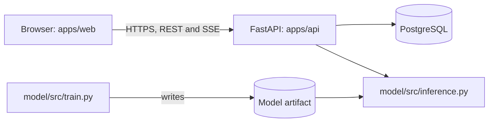
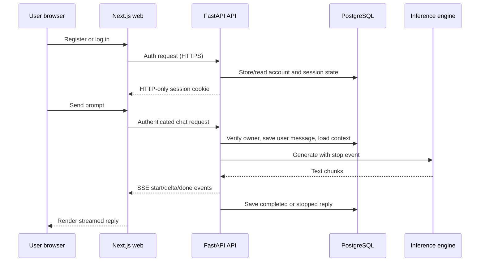
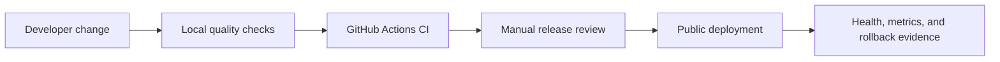

# brainX: Architecture

This is the planned system overview. Details are in [MODEL.md](MODEL.md), [BACKEND.md](BACKEND.md), [FRONTEND.md](FRONTEND.md), [DESIGN.md](DESIGN.md), and [QUALITY.md](QUALITY.md).

## Overview



- **Monorepo:** one repository holds the frontend, backend, and model code.
- **Modular monolith:** there is one backend server, and its code is split into clear modules.
- **Training:** run by hand in a terminal. It never runs inside the server.

## Runtime responsibilities

| Layer | Owns | Never owns |
|---|---|---|
| `apps/web` | Screens, browser interaction, accessible forms, streamed-text rendering, API calls | Database access, model weights, password/session secrets |
| `apps/api` | Authentication, authorization, API validation, database transactions, generation lifecycle, safe errors | Training, browser layout, client-side tokens |
| `model` | Data preparation, tokenizer, model, training, evaluation, checkpoint export, inference contract | HTTP routes, user accounts, database access |
| PostgreSQL | Users, conversations, messages, migrations | Generation state, model artifacts, browser settings |
| `packages/ui` | Reusable visual tokens and presentational components | API requests, account state, business rules |

The important boundary is simple: the browser can ask the API for work; only the API reads the database and model artifact; only the offline training code writes model artifacts.

## Main request flows



Authentication identifies the user. Authorization is repeated on every conversation query, so a guessed ID cannot reveal another user's data. The model has a global generation lock: one reply runs at a time and another request receives the documented busy response rather than exhausting memory.

## Folders

Folders marked "planned" don't exist yet, and each is created by the task that needs it. `model/` is the exception: it exists with empty placeholder files, created at the owner's request (see [MODEL.md](MODEL.md#folder-structure)).

```text
apps/web/             Next.js chat UI and account screens (exists as a starter)
apps/api/             FastAPI server: auth, conversations, chat, inference (planned)
model/                notebooks, src, configs, data, checkpoints, outputs, tests (exists, empty placeholders)
packages/             shared ESLint and TypeScript settings (exist)
docs/                 project documentation
pyproject.toml        uv workspace for apps/api and model (planned)
package.json          JavaScript workspace (exists)
turbo.json            Turborepo tasks (exists)
```

`apps/admin` (the starter's `apps/docs`, renamed) and `packages/ui` are kept as portfolio/supporting UI. `web` is the public chat product; `admin` must not expose private user data.

**Python setup:** a `uv` workspace with `apps/api` and `model` as members. FastAPI imports the model with `from src.inference import ...`. A temporary test confirmed this layout on 2026-11-02, and P1-T6 repeats it in the real repo.

**Turborepo:** `apps/api` has a small `package.json` whose scripts call `uv`, which was also tested. Turborepo's built-in Python support is labelled experimental, so it isn't used. Training and notebooks never run through Turborepo.

## Who can use what

| Code | May use | Must not use |
|---|---|---|
| `apps/web` | `apps/api` over HTTP | Python code or the database |
| `apps/api` | PostgreSQL and `model/src/inference.py` | `train.py`, `data.py`, `evaluate.py` |
| `model/src/inference.py` | `model.py`, `tokenizer.py` | `apps/api` |
| `model/src/train.py` | `model.py`, `tokenizer.py`, `data.py` | `apps/api` |

The backend's internal module rules are in [BACKEND.md](BACKEND.md#modules).

## Quality and delivery boundaries



- Local commands give fast feedback while a task is being built.
- GitHub Actions repeats safe checks in a clean environment; it never trains, deploys, or uses private model data.
- A live release happens only after manual security, ownership, and performance checks. Deployment credentials never appear in the repository.
- [QUALITY.md](QUALITY.md) is the single quality-gate and measurement plan.

## API

The API lives at `http://127.0.0.1:8000/api/v1`. [BACKEND.md](BACKEND.md#api) is the full specification, and the browser reads the same contract.

The backend stores conversations in PostgreSQL. The browser sends only the new message and the conversation ID, and replies stream back with Server-Sent Events.

## Key decisions

| Decision | Why |
|---|---|
| Generate replies inside the API process | One server is simpler, and a separate one would add complexity with little benefit here |
| One reply at a time | The small model is loaded once; a global lock protects memory and public users receive a clear busy response |
| Browser calls FastAPI directly | Avoids a proxy that might buffer the stream; production CORS allows only the deployed web origin |
| PostgreSQL stores conversations | The owner chose it to practise backend engineering, and history needs a database |
| `fastapi.sse`, not `sse-starlette` | The built-in option passed the disconnect test, so another package would be redundant |
| Password accounts in the MVP | Registration and login make the public portfolio usable; authentication implementation is specified in P5-T6A |
| No Redis or background queue | A small portfolio deployment has one generator; rate limits and the busy response protect it before more infrastructure is justified |
| API runs outside Docker locally | Docker on a Mac can't use MPS; production packaging is selected only after P4-T6 measures CPU requirements |
| Full training runs in a terminal | A closed notebook kernel could lose hours of work |

## Tools and versions

Checked on 2026-11-02. Package tables and their test status are in [MODEL.md](MODEL.md#packages), [BACKEND.md](BACKEND.md#packages), and [FRONTEND.md](FRONTEND.md#packages).

| Tool | Version | Status |
|---|---|---|
| Node.js | 26.13.0 | Installed on the Mac |
| pnpm | 11.25.0 | In the repo |
| Turborepo | 2.11.10 | In the repo |
| Next.js / React | 16.3.8 / 19.2.8 | In the repo; passed a build with all frontend packages in a temporary project |
| TypeScript | 7.0.2 | In the repo |
| Python / uv | 3.13.15 / 0.12.15 | Tested |
| PostgreSQL | 18.6 | Installed and running on the Mac |
| Docker | 29.8.1 | Installed; its server didn't respond when checked |

**Starter not confirmed in the real repo:** see P1-T3.

## Performance architecture

Performance is measured separately at four points: training, local inference, API streaming, and public hosting. The system deliberately starts small:

- Training writes pre-tokenized files and resumable checkpoints; it uses MPS only after the hardware check confirms it.
- Inference loads one exported model at startup. CPU and MPS are benchmarked with real weights before choosing a serving device.
- The API moves blocking generation to a worker thread, sends Server-Sent Events, and returns database connections before generation continues.
- The browser batches visible stream updates, loads code highlighting only when needed, and keeps local fonts/assets.

`torch.compile`, mixed precision, quantization, caches, queues, extra workers, and a larger host are optimisation candidates—not promises. Each requires a correct baseline and before/after evidence under [QUALITY.md](QUALITY.md#performance-accelerators-and-guardrails).

## Security and privacy

- Local development listens only on `127.0.0.1`. Production is exposed only behind HTTPS and its hosting platform's network controls.
- CORS allows only the configured local or deployed web origin; it never uses `*` with credentialed requests.
- Passwords are hashed, session credentials use secure HTTP-only cookies, and every conversation query is scoped to its authenticated owner.
- Public requests have input limits, a global generation lock, and a basic per-account or per-IP request limit before deployment.
- Model output is untrusted. Markdown rendering keeps raw HTML disabled, links aren't clickable, and P6-T8 and P6-T9 test this with script tags.
- Checkpoints load with `weights_only=True`.
- Logs never contain prompts or replies, and no telemetry leaves the machine.
- Data, checkpoints, outputs, and `.env` files stay out of git.
