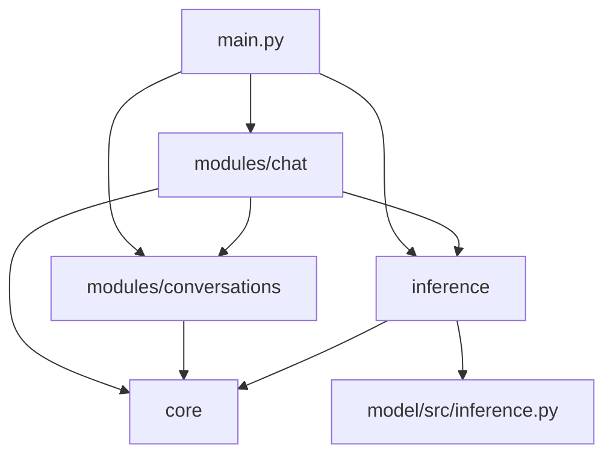
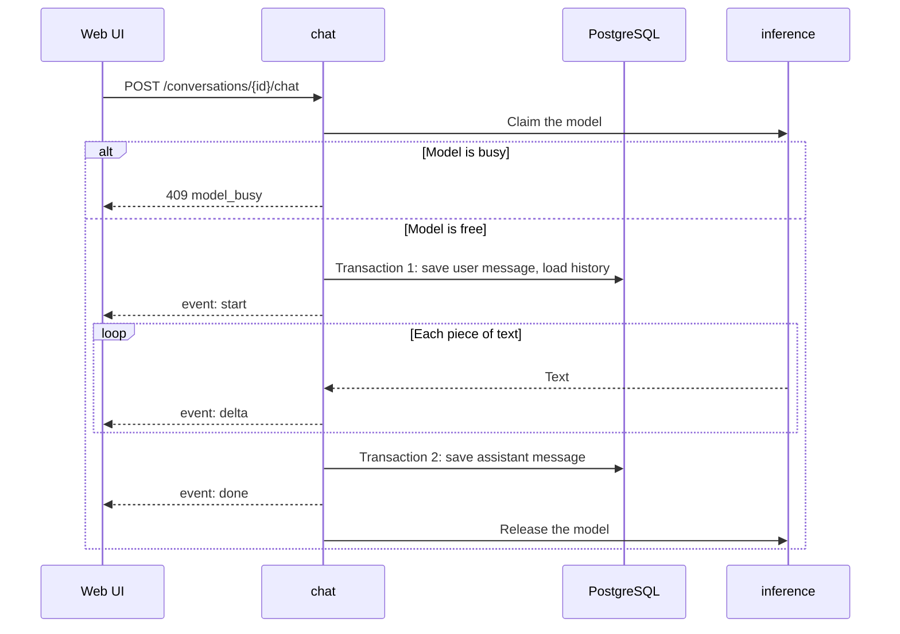
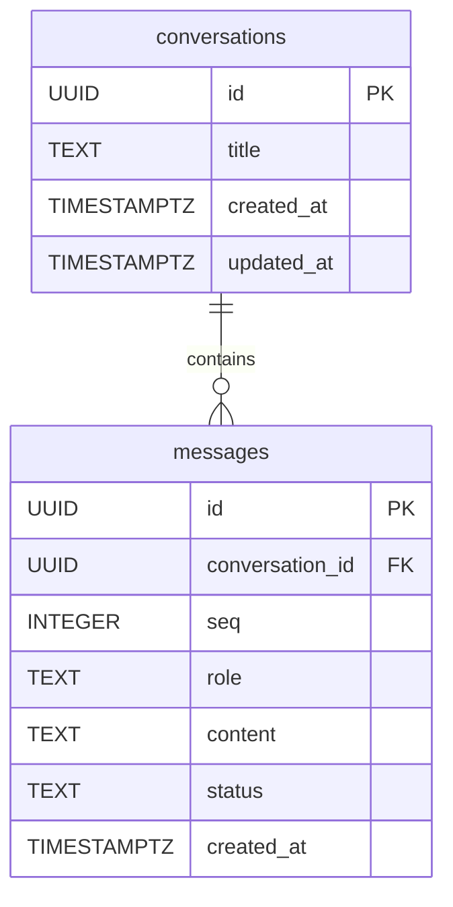

# brainX: Backend

This is the plan for `apps/api`. Nothing here is built yet, and the overall system is in [ARCHITECTURE.md](ARCHITECTURE.md). Phase 5 starts only after the model milestone (P4-T8).

## Tested so far

These ran on 2026-11-02 in temporary folders outside this repo, on Python 3.13.

- The MVP and Portfolio packages resolved and installed together.
- A temporary PostgreSQL 18.6 worked with async SQLAlchemy and asyncpg. An Alembic async migration ran without `psycopg`.
- With a fake token worker, disconnecting the client stopped the worker, using either `fastapi.sse` or `sse-starlette`. P5-T12 must prove this with the real model.
- A local PostgreSQL server is running on this Mac. The Docker server didn't respond, so Docker needs starting before P5-T19.

## Packages

Nothing is installed yet. Each package is added in its task, after approval. Essential packages are required for the MVP, and optional ones are portfolio additions.

| Package | Version | Purpose | Need | Alternative | Compatibility notes | Task |
|---|---:|---|---|---|---|---|
| `fastapi` | 0.162.0 | Web framework, OpenAPI, and SSE | Essential | Litestar | Includes `fastapi.sse` | P5-T1 |
| `uvicorn` | 0.54.0 | Runs the server | Essential | Hypercorn | Use one worker, since the model loads once | P5-T1 |
| `starlette` | 1.10.0 | FastAPI's base | Essential | None | Comes with FastAPI; don't add directly | P5-T1 |
| `pydantic` | 2.14.2 | Request and response validation | Essential | None for FastAPI | Comes with FastAPI | P5-T1 |
| `pydantic-settings` | 2.16.2 | Reads and validates settings | Essential | `os.environ` | Needs Python 3.11+ | P5-T2 |
| `sqlalchemy[asyncio]` | 2.1.6 | ORM and connection pool | Essential | Raw asyncpg | Tested with asyncpg | P5-T4 |
| `asyncpg` | 0.32.0 | PostgreSQL driver | Essential | `psycopg` | Tested with PostgreSQL 18.6 | P5-T4 |
| `alembic` | 1.20.1 | Migrations | Essential | Hand-written SQL | Async template tested | P5-T5 |
| `structlog` | 26.1.0 | Structured logs | Essential | `logging` | Works with request context | P5-T15 |
| `pytest` | 9.2.0 | Tests | Essential | None | Shared with `model/` | P5-T1 |
| `pytest-asyncio` | 1.4.1.post1 | Async tests | Essential | `anyio` plugin | | P5-T4 |
| `httpx` | 0.28.1 | API test client | Essential | None | Dev only | P5-T1 |
| `ruff` | 0.17.3 | Lint and format | Essential | None | Dev only | P5-T1 |
| `mypy` | 2.4.1 | Type checks | Essential | Pyright | Dev only | P5-T1 |
| `prometheus-fastapi-instrumentator` | 8.1.0 | Local `/metrics` | Optional | Hand-written timers | No external service | P5-T18 |
| `pytest-cov` | 7.1.0 | Test coverage | Optional | `coverage` | Dev only | P5-T17 |
| `bandit` | 1.9.4 | Python security scan | Optional | Ruff `S` rules | Dev only | P5-T20 |
| `pip-audit` | 2.10.1 | Known-vulnerability check | Optional | `uv` audit, if available | Dev only; contacts a vulnerability database | P5-T20 |
| `pre-commit` | 4.7.0 | Runs checks before commits | Optional | Manual runs | Dev only | P5-T20 |
| Docker Compose | Docker 29.8.1 installed | Repeatable PostgreSQL | Optional | Local PostgreSQL | PostgreSQL only; the API runs natively | P5-T19 |

### Not used now

| Package | Version | Reason | Add when |
|---|---:|---|---|
| `sse-starlette` | 3.6.0 | Duplicates `fastapi.sse`, which passed the disconnect test | `fastapi.sse` fails P5-T12 |
| `psycopg` | 3.3.6 | asyncpg handled both the app and Alembic | A separate sync need appears |
| `PyJWT`, `pwdlib`, `python-multipart` | 2.15.1, 0.3.1, 0.0.33 | Login isn't in the MVP, and the server is local-only | Login is approved |
| `slowapi` | 0.1.10 | One local user, and one reply at a time is already enforced | The API is exposed to others |
| `redis`, `arq` | 8.1.0, 0.28.0 | Nothing to cache, and no long background jobs | A real need appears |
| FastAPI BackgroundTasks | | Saving a reply must happen inside the stream's lifecycle | A real need appears |
| `rich` | 15.0.0 | `structlog` already prints readable development logs | Not planned |
| `opentelemetry-sdk` | 1.45.2 | One process doesn't need distributed tracing | Not planned |
| `sentry-sdk` | 2.73.0 | Sends data to an outside service | **Only with explicit owner approval** |
| `factory-boy` | 3.3.3 | Two tables can use small helper functions | Test data gets complex |

## Capabilities

| Capability | Class | Decision |
|---|---|---|
| Structured logging | MVP Required | JSON-style logs, without prompt or reply text |
| Database connection pooling | MVP Required | SQLAlchemy's pool, with small limits |
| Async database operations | MVP Required | Async sessions throughout |
| Streaming cancellation | MVP Required | Stop generating on disconnect |
| Model readiness checks | MVP Required | `GET /ready` |
| CORS | MVP Required | Allow one origin |
| Input validation and size limits | MVP Required | Pydantic schemas |
| Graceful shutdown | MVP Required | Stop generation, save the partial reply, close the pool |
| Request correlation IDs | Portfolio Enhancement | Add to logs and error responses |
| Basic security headers | Portfolio Enhancement | Small middleware |
| Performance metrics | Portfolio Enhancement | Local `/metrics` only |
| API rate limiting | Future / Not Needed | The busy check already protects the model |
| Error tracking | Future / Not Needed | Logs are enough, and Sentry would send data out |
| Cache | Future / Not Needed | Nothing expensive is repeated |
| Background tasks | Future / Not Needed | No work outlives a request |

## Modules



| Part | Responsible for | May use | Must not use |
|---|---|---|---|
| `modules/conversations` | Conversation and message data, routes, and database queries | `core` | `chat`, `inference` |
| `modules/chat` | The chat endpoint, streaming, and saving replies | `conversations`, `inference`, `core` | Database tables directly |
| `inference` | Adapter: load model, one-reply lock, worker thread, cancellation, readiness | `core`, `src.inference` | `modules/`, other `src.*` |
| `core` | Config, database, logging, security, and errors | Packages only | `modules/`, `inference` |
| `main.py` | Builds the app, and connects everything | All of the above | Business logic |

P5-T17 adds a small test that reads imports and fails if these rules are broken.

## Folder structure

Folders are created only when a task needs them.

```text
apps/api/
├── src/app/
│   ├── main.py
│   ├── core/
│   │   ├── config.py
│   │   ├── database.py
│   │   ├── logging.py
│   │   ├── security.py
│   │   └── exceptions.py
│   ├── modules/
│   │   ├── chat/         router.py, service.py, schemas.py
│   │   └── conversations/ router.py, service.py, models.py, schemas.py
│   └── inference/        adapter.py
├── migrations/
├── tests/
├── package.json          # lets Turborepo run backend tasks
├── pyproject.toml
└── alembic.ini
```

## Lifecycles

### Request

1. Middleware assigns a request ID, and binds it to logs.
2. Pydantic validates the request.
3. A route gets a database session, and calls its service.
4. A service commits its transaction.
5. Errors become the standard error format.

### Streaming



### Database transactions

- **Transaction 1** saves the user message and reads the history, then commits and returns its connection.
- **No database connection is held during generation**, since a reply can take a while.
- **Transaction 2** saves the assistant message in one short transaction, with status `complete`, `stopped`, or `failed`.
- If the process crashes during generation, the user message remains and the partial reply is lost.

### Cancellation

Pressing Stop aborts the browser's request. The server notices the disconnect and sets `stop_event`, which ends generation at the next token. It then saves the partial reply as `stopped` and releases the model.

### Timeouts

- `max_new_tokens` limits every reply.
- If no token arrives for 30 seconds (a starting value), the reply fails with `generation_timeout`.
- PostgreSQL connections and statements have short timeouts set in `core/database.py`.

### Model loading

- `main.py` loads the model once at startup, in a thread, using `BRAINX_CHECKPOINT`.
- If loading fails, the server still starts. `GET /ready` reports the problem, and chat returns `503`.
- `src.inference` generation is blocking, so it runs in a worker thread and passes text back through a queue.
- Use one Uvicorn worker, because each worker would load its own model.

### Shutdown

Set `stop_event`, wait briefly, save any partial reply, then close the database pool.

## Database

PostgreSQL, using SQLAlchemy 2.x, async sessions, and Alembic migrations.



| Rule | Why |
|---|---|
| UUID primary keys, generated by the app | IDs are safe in URLs and can't be guessed in sequence |
| `conversation_id` foreign key with `ON DELETE CASCADE` | Deleting a chat removes its messages |
| `UNIQUE (conversation_id, seq)` | Gives exact message order, and an index for loading a chat |
| `CHECK (role IN ('user', 'assistant'))` | Rejects invalid roles |
| `CHECK (status IN ('complete', 'stopped', 'failed'))` | The UI needs to show a stopped or failed reply |
| Index on `conversations (updated_at DESC)` | Makes the sidebar list fast |

`seq` and `status` go beyond the minimum entities for the reasons above. There are no other tables.

**Title:** the first 60 characters of the first message, set automatically.

## API

Base path: `http://127.0.0.1:8000/api/v1`. FastAPI publishes the OpenAPI document at `/openapi.json` and the docs at `/docs`. **That generated document is the source of truth for schemas**, and this section explains how the API behaves.

| Method and path | Purpose | Success |
|---|---|---|
| `GET /health` | The process is alive | `200 { "status": "ok" }` |
| `GET /ready` | Database, model, and generation limits | `200` |
| `POST /conversations` | Create | `201 Conversation` |
| `GET /conversations?limit=50&offset=0` | List, newest first | `200 { items, total }` |
| `GET /conversations/{id}` | Read one | `200 Conversation` |
| `DELETE /conversations/{id}` | Delete with its messages | `204` |
| `GET /conversations/{id}/messages?limit=100&offset=0` | Messages, in order | `200 { items, total }` |
| `POST /conversations/{id}/chat` | Send a message | `200`, SSE stream |

```text
Conversation  { id, title, created_at, updated_at }
Message       { id, conversation_id, seq, role, content, status, created_at }
```

**Limits:** `limit` is at most 100. `content` is 1-4000 characters.

### `GET /ready`

```json
{
  "status": "ready",
  "database": true,
  "model_loaded": true,
  "generation": {
    "defaults": { "temperature": 0.8, "top_k": 40, "top_p": 0.95, "max_new_tokens": 200 },
    "limits": {
      "temperature": [0.0, 2.0],
      "top_k": [1, 200],
      "top_p": [0.1, 1.0],
      "max_new_tokens": [1, 300]
    }
  }
}
```

`status` is `degraded` if the database or model isn't available, so the UI can still read the limits and explain the problem.

### `POST /conversations/{id}/chat`

```json
{
  "content": "Why does it fall?",
  "generation": { "temperature": 0.8, "max_new_tokens": 200 }
}
```

The server reads earlier messages from the database. `generation` is optional, and any missing field uses the default.

### Stream events

```text
event: start
data: {"user_message_id":"...","assistant_message_id":"..."}

event: delta
data: {"text":"Rain"}

event: done
data: {"finish_reason":"stop","generated_tokens":42}

event: error
data: {"code":"generation_failed","message":"Generation failed","request_id":"..."}
```

`finish_reason` is `stop` or `length`. A stopped reply has no `done` event, because the client has already disconnected.

### Errors

Errors before streaming starts use one format:

```json
{ "error": { "code": "model_busy", "message": "...", "request_id": "..." } }
```

| Status | Code | When |
|---|---|---|
| 404 | `conversation_not_found` | Unknown ID |
| 409 | `model_busy` | Another reply is generating, or that chat is being deleted while it generates |
| 422 | `invalid_request` | Failed validation |
| 503 | `model_unavailable` | No model is loaded |
| 503 | `database_unavailable` | PostgreSQL can't be reached |
| 500 | `internal_error` | Unexpected; details stay in the logs |

During streaming, a failure sends an `error` event with `generation_failed` or `generation_timeout`, and the partial reply is saved as `failed`.

## Configuration

`core/config.py` validates these at startup, and a bad value stops the server with a clear message. `.env.example` is committed, and `.env` is not.

| Setting | Default | Purpose |
|---|---|---|
| `BRAINX_DATABASE_URL` | Required | Async PostgreSQL URL |
| `BRAINX_CHECKPOINT` | None | Model artifact folder |
| `BRAINX_DEVICE` | `cpu` | Generation device |
| `BRAINX_CORS_ORIGIN` | `http://localhost:3000` | The one allowed browser origin |
| `BRAINX_LOG_LEVEL` | `INFO` | Log detail |

## Testing

| Level | Covers | How |
|---|---|---|
| Unit | Services, adapter lock, error mapping | pytest |
| Database | Constraints, cascade, ordering, migrations | A real PostgreSQL test database |
| API | Every route and error | `httpx` against the app |
| Streaming | Event order, stop, failure, and saved status | A fake engine with the same interface as `src.inference` |
| Integration | The real model path | A small test checkpoint, using a real server for disconnects |
| Boundaries | Import rules | A small import-checking test |

Tests use PostgreSQL, not SQLite, so constraints behave the same as in the real system. The model is faked only where the test is about the API.

## Security and observability

**Security:**

- The server binds to `127.0.0.1`, with CORS limited to one origin.
- There is no login, so **it must not be exposed to a network**.
- Pydantic enforces input sizes, and SQLAlchemy parameterises queries.
- Security headers include `X-Content-Type-Options` and `Referrer-Policy`.
- Checkpoints load with `weights_only=True`.
- Secrets stay in `.env`.
- `bandit` and `pip-audit` run in P5-T20.

**Observability:**

- Logs contain request ID, route, status, duration, and token counts. **They never contain prompts or replies.**
- `/metrics` stays local, and tracks request counts and timing.
- No data leaves the machine.

## Tasks

Each task needs approval first. Run commands from the repo root, once P1-T6 has set up `uv`. `pytest` below means `uv run --package brainx-api pytest`.

### P5-T1: FastAPI setup

- **Objective:** Run a minimal API.
- **Dependencies:** P4-T8.
- **Files:** `apps/api/pyproject.toml`, `apps/api/package.json`, `apps/api/src/app/main.py`, `apps/api/tests/test_health.py`, root `pyproject.toml`*, `uv.lock`*.
- **Steps:** Add packages and `GET /api/v1/health`, then connect it to Turborepo.
- **Acceptance:** The test passes, and the server listens only on `127.0.0.1`.
- **Verify:** `pytest apps/api/tests/test_health.py`
- **Learning:** What a route and an ASGI server are.

### P5-T2: Configuration

- **Objective:** Validate settings in one place.
- **Dependencies:** P5-T1.
- **Files:** `apps/api/src/app/core/config.py`, `.env.example`, `apps/api/tests/test_config.py`, `apps/api/pyproject.toml`*, `uv.lock`*.
- **Steps:** Add `pydantic-settings` and the documented settings.
- **Acceptance:** A missing database URL gives a clear error.
- **Verify:** `pytest apps/api/tests/test_config.py`
- **Learning:** Why config stays out of code.

### P5-T3: PostgreSQL setup

- **Objective:** Create development and test databases.
- **Dependencies:** P5-T2.
- **Files:** `docs/BACKEND.md`*, `.env.example`*.
- **Steps:** Explain and, with approval, create `brainx` and `brainx_test` on the local server, without touching other databases.
- **Acceptance:** Both connect with `psql`.
- **Verify:** `psql "$BRAINX_DATABASE_URL_SYNC" -c "select version()"`, where that variable holds a plain `postgresql://` URL for the check.
- **Learning:** What a database server, database, and role are.

### P5-T4: Async ORM

- **Objective:** Connect the app to PostgreSQL asynchronously.
- **Dependencies:** P5-T3.
- **Files:** `apps/api/src/app/core/database.py`, `apps/api/tests/test_database.py`, `apps/api/tests/conftest.py`, `apps/api/pyproject.toml`*, `uv.lock`*.
- **Steps:** Add the engine, pool, and session dependency.
- **Acceptance:** An async test query runs, and the session closes after use.
- **Verify:** `pytest apps/api/tests/test_database.py`
- **Learning:** What async I/O and a connection pool do.

### P5-T5: Alembic

- **Objective:** Set up migrations.
- **Dependencies:** P5-T4.
- **Files:** `apps/api/alembic.ini`, `apps/api/migrations/`, `apps/api/pyproject.toml`*, `uv.lock`*.
- **Steps:** Set up the async template, using the configured database URL.
- **Acceptance:** An empty migration upgrades and downgrades.
- **Verify:** `uv run --package brainx-api alembic -c apps/api/alembic.ini upgrade head`
- **Learning:** Why schema changes are versioned.

### P5-T6: Database models

- **Objective:** Create both tables.
- **Dependencies:** P5-T5.
- **Files:** `apps/api/src/app/modules/conversations/models.py`, `apps/api/migrations/versions/`, `apps/api/tests/test_models.py`.
- **Steps:** Add models, constraints, and indexes, then write the migration.
- **Acceptance:** Tests cover cascade, unique order, and invalid values. Migrating up and down works.
- **Verify:** `pytest apps/api/tests/test_models.py`
- **Learning:** What constraints protect against.

### P5-T7: API schemas and error format

- **Objective:** Define inputs, outputs, and the standard error.
- **Dependencies:** P5-T6.
- **Files:** `apps/api/src/app/modules/conversations/schemas.py`, `apps/api/src/app/core/exceptions.py`, `apps/api/src/app/main.py`*, `apps/api/tests/test_errors.py`.
- **Steps:** Add Pydantic schemas and central error handlers.
- **Acceptance:** Validation errors return the documented format.
- **Verify:** `pytest apps/api/tests/test_errors.py`
- **Learning:** How Pydantic and OpenAPI connect.

### P5-T8: Conversation endpoints

- **Objective:** Create, list, read, and delete conversations.
- **Dependencies:** P5-T7.
- **Files:** `apps/api/src/app/modules/conversations/router.py`, `apps/api/src/app/modules/conversations/service.py`, `apps/api/src/app/main.py`*, `apps/api/tests/test_conversations.py`.
- **Steps:** Add the service and routes, with pagination.
- **Acceptance:** Each route and `404` is tested.
- **Verify:** `pytest apps/api/tests/test_conversations.py`
- **Learning:** Why routes and services are kept separate.

### P5-T9: Message retrieval

- **Objective:** Read a conversation's messages.
- **Dependencies:** P5-T8.
- **Files:** `apps/api/src/app/modules/conversations/router.py`*, `apps/api/src/app/modules/conversations/service.py`*, `apps/api/tests/test_conversations.py`*.
- **Steps:** Add the paginated route, plus the methods chat needs to save messages.
- **Acceptance:** Order and limits are tested.
- **Verify:** `pytest apps/api/tests/test_conversations.py`
- **Learning:** How pagination works.

### P5-T10: Local model integration

- **Objective:** Load the model safely, and report its state.
- **Dependencies:** P5-T9.
- **Files:** `apps/api/src/app/inference/adapter.py`, `apps/api/src/app/main.py`*, `apps/api/tests/test_inference_adapter.py`.
- **Steps:** Add startup loading, the one-reply lock, and `GET /ready`.
- **Acceptance:** A missing model doesn't crash the server, and readiness reports it. A test checkpoint loads.
- **Verify:** `pytest apps/api/tests/test_inference_adapter.py`
- **Learning:** What an adapter is, and why the API doesn't call model code directly.

### P5-T11: Chat endpoint and SSE streaming

- **Objective:** Stream a reply, and save it.
- **Dependencies:** P5-T10.
- **Files:** `apps/api/src/app/modules/chat/`, `apps/api/src/app/inference/adapter.py`*, `apps/api/src/app/main.py`*, `apps/api/tests/test_chat.py`.
- **Steps:** Add the route, worker thread, queue, `fastapi.sse` events, and two short transactions.
- **Acceptance:** Events arrive in order, and both messages are saved. No database connection is held during generation.
- **Verify:** `pytest apps/api/tests/test_chat.py`
- **Learning:** How SSE works, and how a thread passes data to async code.

### P5-T12: Cancellation

- **Objective:** Stop generating on disconnect.
- **Dependencies:** P5-T11.
- **Files:** `apps/api/src/app/modules/chat/`*, `apps/api/src/app/inference/adapter.py`*, `apps/api/tests/test_cancellation.py`.
- **Steps:** Connect the disconnect to `stop_event`, and save the partial reply.
- **Acceptance:** A real server test shows that generation stops, the reply is `stopped`, and the model is free. If `fastapi.sse` fails, stop and ask before adding a package.
- **Verify:** `pytest apps/api/tests/test_cancellation.py`
- **Learning:** How cancellation moves from the browser to the model.

### P5-T13: Generation settings

- **Objective:** Accept per-message settings.
- **Dependencies:** P5-T12.
- **Files:** `apps/api/src/app/modules/chat/`*, `apps/api/tests/test_chat.py`*.
- **Steps:** Validate settings against the published limits, and pass them to the engine.
- **Acceptance:** Values at and beyond each limit are tested.
- **Verify:** `pytest apps/api/tests/test_chat.py`
- **Learning:** Why the server is the authority on limits.

### P5-T14: Error handling

- **Objective:** Make every failure clear and safe.
- **Dependencies:** P5-T13.
- **Files:** `apps/api/src/app/core/exceptions.py`*, `apps/api/src/app/modules/chat/`*, `apps/api/src/app/core/database.py`*, `apps/api/tests/test_errors.py`*.
- **Steps:** Add busy, no model, database failure, generation failure, and timeout handling.
- **Acceptance:** Each documented error is tested, and the model is always released.
- **Verify:** `pytest apps/api/tests/test_errors.py`
- **Learning:** Why internal details don't belong in error responses.

### P5-T15: Structured logging

- **Objective:** Make the server's behaviour traceable.
- **Dependencies:** P5-T14.
- **Files:** `apps/api/src/app/core/logging.py`, `apps/api/src/app/main.py`*, `apps/api/tests/test_logging.py`, `apps/api/pyproject.toml`*, `uv.lock`*.
- **Steps:** Add `structlog`, request IDs, and request logs.
- **Acceptance:** A response and its logs share an ID. A test confirms that prompts aren't logged.
- **Verify:** `pytest apps/api/tests/test_logging.py`
- **Learning:** What correlation IDs help you debug.

### P5-T16: Security and shutdown

- **Objective:** Apply the security plan and clean shutdown.
- **Dependencies:** P5-T15.
- **Files:** `apps/api/src/app/core/security.py`, `apps/api/src/app/main.py`*, `apps/api/tests/test_security.py`.
- **Steps:** Add CORS, security headers, and graceful shutdown.
- **Acceptance:** The allowed origin works, others are refused, and headers are present. Shutdown saves a partial reply.
- **Verify:** `pytest apps/api/tests/test_security.py`
- **Learning:** What CORS does and doesn't protect.

### P5-T17: Test coverage and boundaries

- **Objective:** Fill important test gaps.
- **Dependencies:** P5-T16.
- **Files:** `apps/api/tests/`, `apps/api/pyproject.toml`*, `uv.lock`*.
- **Steps:** Add `pytest-cov` and the import-rule test, then cover missing critical paths.
- **Acceptance:** Breaking an import rule fails the test. Coverage is reported as measured, with no invented target.
- **Verify:** `pytest apps/api/tests --cov=app`
- **Learning:** What coverage does and doesn't prove.

### P5-T18: Performance checks

- **Objective:** Measure the real backend.
- **Dependencies:** P5-T17.
- **Files:** `apps/api/src/app/main.py`*, `apps/api/pyproject.toml`*, `uv.lock`*, `docs/BACKEND.md`*.
- **Steps:** Add local `/metrics`. Measure time to first token, tokens per second, and memory.
- **Acceptance:** Real numbers are recorded, and no target is claimed without a measurement.
- **Verify:** `curl http://127.0.0.1:8000/metrics`
- **Learning:** The difference between latency and throughput.

### P5-T19: Docker setup

- **Objective:** Offer a repeatable PostgreSQL.
- **Dependencies:** P5-T18.
- **Files:** `compose.yaml`, `.env.example`*, `docs/BACKEND.md`*.
- **Steps:** Start Docker, and add one PostgreSQL service on a separate port, with a named volume.
- **Acceptance:** Migrations and tests pass against it, while local PostgreSQL stays untouched.
- **Verify:** `docker compose up -d` then `pytest apps/api/tests/test_database.py`
- **Learning:** What containers and volumes are, and why the API stays outside Docker here.

### P5-T20: Security scans and pre-commit

- **Objective:** Automate quality checks.
- **Dependencies:** P5-T19.
- **Files:** `.pre-commit-config.yaml`, `apps/api/pyproject.toml`*, `uv.lock`*.
- **Steps:** Add `bandit`, `pip-audit`, and `pre-commit`, with `ruff` and `mypy`. Explain each finding.
- **Acceptance:** Scans ran, and their real findings are fixed or recorded.
- **Verify:** `uv run --package brainx-api pre-commit run --all-files`
- **Learning:** How to judge a scanner's finding.
