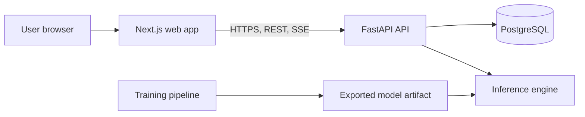

# brainX: Application and Development Overview

## What brainX is

brainX is a public portfolio chatbot built to demonstrate end-to-end full-stack and machine-learning engineering. A registered user will send a text prompt in a browser and receive a streamed text response from a small language model trained in this repository.

The project is intentionally honest about its scope. The model is trained from scratch on one Mac, not backed by an external AI API or pre-trained weights. It is expected to produce simple English responses, but it will not match ChatGPT-level factual accuracy, reasoning, or long-context performance.

## Current reality

The repository contains the documentation, the shared UI foundation, and static web/admin previews. The model, API, database schema, authentication, real chat flow, CI workflow, and deployment are **planned but not built yet**. This distinction matters: documentation explains the intended system; [PROGRESS.md](PROGRESS.md) records what has actually been verified.

## Application map



| Part | Responsibility | Main documentation |
|---|---|---|
| `apps/web` | Login, registration, chat UI, settings, streamed reply display | [FRONTEND.md](FRONTEND.md), [DESIGN.md](DESIGN.md) |
| `apps/api` | Authentication, authorization, validation, conversations, SSE, model lifecycle | [BACKEND.md](BACKEND.md) |
| `model` | Data, tokenizer, Transformer, training, evaluation, export, inference | [MODEL.md](MODEL.md) |
| PostgreSQL | Users, conversations, messages, migrations | [BACKEND.md](BACKEND.md#database) |
| `packages/ui` | Shared design tokens and reusable UI primitives | [DESIGN.md](DESIGN.md#design-system-architecture) |
| GitHub Actions | Repeatable quality checks in a clean environment | [QUALITY.md](QUALITY.md#github-actions-plan) |

## How the finished product works

1. A visitor registers or logs in with email and password.
2. The API creates an HTTP-only authenticated session; browser JavaScript never stores the password or session secret.
3. The user creates a chat and sends a prompt.
4. The API checks account ownership, saves the message, loads context that fits the model window, and begins generation.
5. The model returns text chunks. The API streams them as SSE events, and the browser renders them smoothly.
6. The API saves a completed, stopped, or failed reply. Only the owner can reopen or delete that conversation.
7. Before public release, HTTPS, CORS, secure cookies, rate limits, health checks, testing, and rollback instructions are verified.

## Documentation reading order

| Read first | Why |
|---|---|
| [README.md](../README.md) | Product summary, current status, technology choices, and limitations |
| [PROJECT.md](PROJECT.md) | Confirmed product scope and acceptance map |
| [ARCHITECTURE.md](ARCHITECTURE.md) | Component boundaries and request flow |
| [TASKS.md](TASKS.md) | Ordered implementation tasks |
| [MODEL.md](MODEL.md) | Model and training plan |
| [BACKEND.md](BACKEND.md) | API and database plan |
| [FRONTEND.md](FRONTEND.md) and [DESIGN.md](DESIGN.md) | UI system and interaction design |
| [QUALITY.md](QUALITY.md) | Tests, performance evidence, CI, and release gates |
| [GUIDE.md](GUIDE.md) | Safe workflow when working with an AI coding agent |

## Commands available today

These commands exist now. They operate on the current static UI foundation; they do not train a model or start an API.

```bash
pnpm dev
pnpm lint
pnpm check-types
pnpm build
pnpm boundaries
```

`pnpm dev` starts the static web preview at `http://localhost:3000` and the admin preview at `http://localhost:3001`. The pages are not connected to an API or model yet.

Commands for Python, datasets, model training, API tests, browser E2E tests, CI, and production deployment are intentionally not listed as ready commands until the task that creates and verifies them is complete.

## Development roadmap

```text
Phase 1  Foundation: clean starter files, Python workspace, CI baseline
Phase 2  Data and tokenizer: inspect hardware, select data, clean/split, train BPE
Phase 3  Model and training: implement Transformer, checkpointing, smoke test, full training
Phase 4  Evaluation and export: benchmark quality/speed, test inference, export artifact
Phase 5  Backend: FastAPI, PostgreSQL, accounts, authorization, streaming API
Phase 6  Frontend: authentication pages, real chat, state, responsive/accessibility work
Phase 7  Integration: real model, browser flows, ownership and failure tests
Phase 8  Release: final checks, portfolio material, HTTPS deployment
```

The model is the first major product track, but training cannot safely be the first shell command. It depends on the Python workspace, measured hardware, licensed dataset decisions, tokenizer, model code, checkpoints, and a smoke test. Full pre-training is `P3-T9`; it needs a separate explicit approval.

## Quality and performance

The product will be measured, not described with invented numbers. The evidence includes training throughput and loss, inference time-to-first-token and tokens/second, API/database behaviour, browser interaction/layout performance, and public-host capacity. The benchmark baseline comes before optional accelerators such as MPS tuning, `torch.compile`, mixed precision, quantization, extra workers, caches, or larger hosting.

See [QUALITY.md](QUALITY.md) for the complete test matrix, GitHub Actions plan, metrics, and release gate.

## Live deployment

The finished application will be publicly deployed only after the model works locally and real CPU memory/latency measurements exist. The hosting provider, domain, budget, and production secrets are intentionally undecided until then. This prevents selecting a host that cannot run the exported model reliably.

Deployment is a separate approved task. It includes HTTPS, environment secrets outside git, migrations, health checks, account/ownership tests, one real streamed chat, a documented live URL, and rollback instructions.
