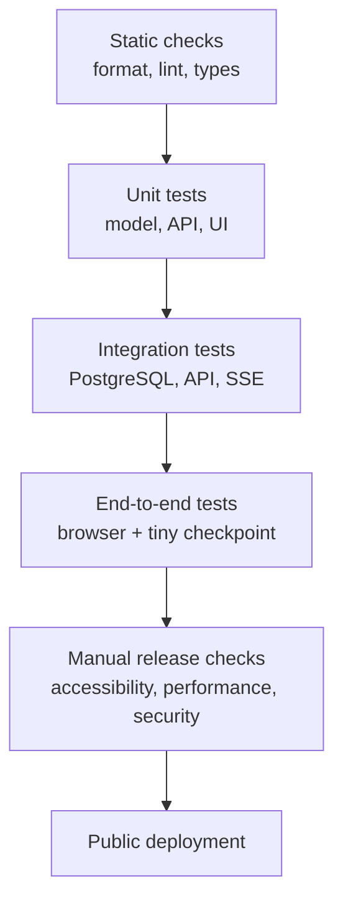

# brainX: Quality, Testing, Performance, and Delivery

This document defines how brainX earns a professional portfolio claim. It is a **plan**, not a statement that these checks already pass. A check becomes a result only when its command, environment, date, and real output are recorded in [PROGRESS.md](PROGRESS.md).

## Quality model

Each lower layer is fast and narrow. Higher layers are slower but prove that real pieces work together. A browser test does not replace a model test, and a successful build does not prove account ownership or streaming cancellation.

## Test matrix

| Layer | What it proves | Tool or method | First task |
|---|---|---|---|
| Formatting, lint, types | Consistent code and basic static errors | Prettier, ESLint, TypeScript, Ruff, mypy | P1-T3, P5-T1, P6-T1 |
| Model unit tests | Tokenizer round trips, causal mask, loss, checkpoint loading, generation stopping | `pytest` | P1-T6 through P4-T8 |
| Backend unit/API tests | Validation, auth, ownership, database rules, errors, SSE event order | `pytest`, `httpx`, real PostgreSQL | P5-T1 through P5-T17 |
| Frontend component tests | Form validation, state, keyboard controls, rendering safety | Vitest, Testing Library | P6-T1 through P6-T16 |
| End-to-end tests | Register/login, chat, stream, stop, reload, delete, authorization | Playwright with a tiny local checkpoint and test database | P7-T3, P7-T4 |
| Security checks | Dependency issues, insecure patterns, secrets, browser storage and cross-user access | `bandit`, `pip-audit`, review, browser/API tests | P5-T16, P5-T20, P7-T4 |
| Release checks | HTTPS, health, live account flow, rollback instructions | Private browser window and deployed health check | P8-T6 |

## GitHub Actions plan

There is **no workflow file yet**. P1-T7 creates `.github/workflows/ci.yml`; until then, GitHub does not automatically run any check.

| Trigger | Required checks at that stage | Rules |
|---|---|---|
| Push or pull request | `pnpm install --frozen-lockfile`, `pnpm lint`, `pnpm check-types`, `pnpm build` | Must run from a clean checkout; cache dependencies only, never model data or checkpoints |
| After P1-T6 | Python sync and model setup test | Uses lockfiles; no training and no dataset download in CI |
| After Phase 5 | Backend tests against an isolated PostgreSQL service | Uses test credentials and a disposable database only |
| After Phase 6 | Frontend component tests | Does not require production API secrets |
| After Phase 7 | Playwright E2E with the tiny generated checkpoint | Never downloads or uses the real model/data |
| Before release | All available checks plus deployment configuration review | Deployment is still manual and needs the owner's explicit approval |

The workflow reports test output and coverage as measured artifacts when those tools exist. It must fail on a failed check, but it must not commit, deploy, upload private data, or train the model.

## Performance evidence

brainX does not claim a speed target before measuring it on the real model and deployment hardware. Instead, every performance task records the following evidence.

| Area | Measurements | Where recorded | First measurement |
|---|---|---|---|
| Training | tokens/second, peak memory, loss, validation loss, checkpoint size, elapsed time | Run folder and `metrics.jsonl` | P3-T6 |
| Inference | load time, time to first token, tokens/second, peak memory, generated-token count | P4-T6, P5-T18 | P4-T6 |
| API | `/ready` health, request duration, time to first SSE token, error/busy count, database timing | Local logs and `/metrics` | P5-T18 |
| Database | migration time, query shape, pagination behaviour, ownership filtering | API/database tests and query review | P5-T6 through P5-T9 |
| Browser | loading, streaming smoothness, layout shift, keyboard response, bundle impact of code highlighting | Browser DevTools/Lighthouse-style audit after feature completion | P6-T16 |
| Public deployment | cold start, time to first token, memory, concurrent/busy behaviour, HTTPS health | P8-T6 evidence | P8-T6 |

After the first measured baseline, the owner chooses realistic pass/fail budgets for the actual hardware. Later runs compare against that baseline instead of guessing a number borrowed from a larger service.

## Performance accelerators and guardrails

| Layer | Use deliberately | Do not assume |
|---|---|---|
| Training | Apple MPS when available; fixed seeds; pre-tokenized files; checkpoint/resume; profile batch size and context length | Mixed precision or `torch.compile` is faster on this Mac; each must beat the float32 baseline in P3-T6 before adoption |
| Inference | Load one artifact at startup; CPU/MPS benchmark; streaming iterator; stop event; maximum output length | More workers improve throughput; each worker would load another model copy |
| API | One generation lock; worker thread for blocking generation; SSE; async database pool; indexed ownership queries | Redis, queues, caching, or horizontal scaling are needed before measurements prove it |
| Frontend | Server-first rendering where suitable; dynamic-load Shiki; batch visible stream updates; local fonts/assets; avoid unnecessary client state | Animation, a large component library, or extra state library makes the product faster |
| Deployment | Choose CPU/RAM from P4-T6 and P5-T18 evidence; health checks; bounded public traffic | A free host can keep a model warm or deliver the same speed as the Mac |

An optimisation is accepted only when it keeps outputs correct, has a before/after measurement, does not make the code harder to understand without benefit, and passes the same tests as the baseline.

## Observability and privacy

- `/health` answers whether the process is running; `/ready` also reports model/database readiness without exposing secrets.
- Structured logs record route, status, duration, request ID, and token counts. They never record passwords, prompts, replies, session credentials, or model weights.
- Local `/metrics` and deployment metrics are for measured performance, not a third-party tracking service.
- A failure report records the symptom, timestamp, environment, request ID, safe reproduction steps, and fix status. Sensitive content is redacted.

## Release gate

Before a public update, the owner reviews this checklist:

1. CI checks available at that phase are green from a clean checkout.
2. Model result and limitation statements trace to a real run folder.
3. Registration, login, logout, and cross-user denial are tested in fresh browser sessions.
4. HTTPS, secure cookies, CORS origin, rate limits, and environment secrets are checked for the production host.
5. The deployed health check, one streamed chat, and the rollback command are documented.
6. The README uses real screenshots, URL, costs/limits if known, and no invented performance claim.
