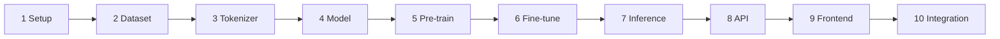

# brainX: Roadmap

**Status:** Proposed, awaiting owner approval. **Current phase:** none. No implementation has started.

**How to use this file:** each task is small enough for one coding-agent session, using the rules and prompt in [AI_AGENT_RULES.md](AI_AGENT_RULES.md). Tick a task only after its check really ran and passed.

**What each task carries:** its ID, acceptance criteria, and check are in its row. Its modules, allowed files, and gate come from its phase. Its prerequisites are the previous task in that phase, plus any listed under [Task dependencies](#task-dependencies).

**Commands below are planned.** Most don't exist until their task creates them. The agent must report any that needs to change.

Backend commands run from `apps/backend/`. Long training runs are started by the owner, or by an agent only with explicit approval.

## Phase order



**The gate between phases (C8):** run every gate check, write down the results in a report, and get the owner's approval. A failed check blocks the next phase, whichever check it is.

## Task dependencies

Within a phase, tasks run in order. These cross-phase links are the ones that matter most.

| Task | Needs | Why |
|---|---|---|
| T2.1 | T1.5 | Backend project must exist |
| T3.2 | T2.5 | Tokenizer trains on a sample of all four cleaned datasets |
| T3.5 | T3.3, T2.5 | Encoding needs tokenizer and cleaned data |
| T4.4 | T4.2 | Sampling needs the model |
| T5.1 | T3.5, T4.3 | Training needs token files and a model |
| T5.5 | T4.4 | Sample outputs during training |
| T6.1 | T3.4, T2.5 | Instruction batches need chat format and data |
| T6.2 | T5.6 | Fine-tuning needs the pre-trained checkpoint |
| T7.1 | T3.3, T4.4 | Engine wraps tokenizer and sampling |
| T7.5 | T6.4 | Tuning needs the selected checkpoint |
| T8.3 | T8.2 | Routes need storage |
| T8.4 | T7.3, T8.3 | Streaming connects engine and storage |
| T9.3 | T8.6 | UI needs the final API |
| T10.1 | T9.7 | End-to-end test needs the whole app |

## Phase 1: Project planning and repository setup

**Objective:** turn the starter into the project's working skeleton.
**Prerequisites:** owner approves these documents and answers D2.
**Modules:** workspace only.
**Allowed paths:** root config files, `AGENTS.md`, `CLAUDE.md`, `README.md`, `apps/docs/`, `apps/web/`, `apps/backend/`, `packages/ui/`, `docs/`.

| ID | Task | Acceptance |
|---|---|---|
| [ ] T1.1 | Extend root `.gitignore`: `.turbo`, `.DS_Store`, `.env`, `.venv`, `__pycache__`, `apps/backend/{data,artifacts,var}`. Untrack `.DS_Store`. | `git check-ignore` confirms each path |
| [ ] T1.2 | Rename root package to `brainx`. Expand the one-line README into a project overview and setup guide. | README commands match real scripts |
| [ ] T1.3 | Add `CLAUDE.md`, and add a rules pointer to `AGENTS.md` **without changing Turborepo's managed block**. | Both point to `docs/AI_AGENT_RULES.md` |
| [ ] T1.4 | If D2 is approved: remove `apps/docs` and `packages/ui`, and remove `@repo/ui` use from `apps/web`. | `pnpm build` and `pnpm check-types` pass |
| [ ] T1.5 | Add `apps/backend` with `pyproject.toml`, `.python-version` (3.13), lockfile, all dependencies from TECH_STACK.md, and an empty `src/brainx/` folder for each module in ARCHITECTURE.md. | `uv sync` works, and `import brainx` works |
| [ ] T1.6 | Add `apps/backend/package.json` wrapper scripts, a `test` task in `turbo.json`, and a root `test` script. Read Turborepo's bundled docs first. | Turborepo lists and runs backend tasks |
| [ ] T1.7 | Add `import-linter` contracts and the banned-dependency test. | A deliberate rule violation fails, then is removed |
| [ ] T1.8 | Confirm Tailwind 4 in `apps/web`, with one visible styled element. | Style shows on the running page |

**Gate:**

```bash
pnpm install --frozen-lockfile && pnpm lint && pnpm check-types && pnpm build && pnpm test
```

**Done when:** one command checks both languages, and the banned-dependency test runs.
**Risks:** the starter's Next.js 16.3.8 fails under TypeScript 7, in which case use the 5.9.3 fallback. A Turborepo wrapper problem would be resolved through ADR-002's approach, not by enabling the experimental flag without approval.
**Git note:** stage named paths only.

## Phase 2: Dataset collection and preprocessing

**Objective:** clean, split, documented text.
**Prerequisites:** Phase 1 gate. Owner answers D1 and D4.
**Modules:** `dataset`.
**Allowed paths:** `apps/backend/src/brainx/dataset/`, `tests/dataset/`, `configs/data*`, gitignored `data/`.

| ID | Task | Acceptance |
|---|---|---|
| [ ] T2.1 | Confirm each source's licence, and pin the exact dataset revision in a config. | Each source has a recorded licence and revision, and Simple Wikipedia's is resolved or replaced |
| [ ] T2.2 | Write the download command, saving raw data under `data/raw/`. | Re-running doesn't download again |
| [ ] T2.3 | Write text cleaning and hash-based splitting for pre-training text. | Tests cover cleaning, duplicates, and stable splits |
| [ ] T2.4 | Write manifest output, with counts for each stage. | Manifest contains hashes and row counts |
| [ ] T2.5 | Convert Dolly and OASST1 into one conversation format, using the filter rules in AI_MODEL.md. | Tests use small fixtures, including a branching OASST tree |
| [ ] T2.6 | Write a short data report: real counts, sample rows, problems found, `detoxify` findings. | Report is based on real output |

**Gate:**

```bash
uv run pytest tests/dataset && uv run python -m brainx.dataset.prepare --all
```

Then the owner reads the data report and random samples.

**Done when:** manifests exist for all sources and splits have no overlap.
**Risks:** an unresolved licence, or too few conversations after filtering. Either is reported to the owner, not worked around.

## Phase 3: Tokenizer development

**Objective:** a tested BPE tokenizer and encoded datasets.
**Prerequisites:** Phase 2 gate and D3.
**Modules:** `tokenizer`, `dataset`.
**Allowed paths:** `src/brainx/tokenizer/`, `src/brainx/dataset/`, `tests/tokenizer/`, `tests/dataset/`, gitignored `artifacts/tokenizer/` and `data/tokens/`.

| ID | Task | Acceptance |
|---|---|---|
| [ ] T3.1 | Write BPE training on a small fixture, checking hand-calculated merges. | Result equals the hand-worked example |
| [ ] T3.2 | Add special tokens and train on the real sample, saving as JSON. | Vocabulary has exactly 8,000 tokens |
| [ ] T3.3 | Write encode/decode, a word cache, and streaming decode. | Round-trip passes on Unicode, emoji, and empty text. Split characters are held back correctly |
| [ ] T3.4 | Write `format_chat()`. | Test checks its exact token order and role boundaries |
| [ ] T3.5 | Write encoding to memory-mapped files of 16-bit values, with time and size reported. | Decoding a slice returns the source text |

**Gate:**

```bash
uv run pytest tests/tokenizer tests/dataset
```

Then the owner inspects 20 tokenized sentences and the common merges.

**Done when:** token files and tokenizer hash are recorded, and the vocabulary is frozen.
**Risks:** Python training is too slow, so reduce the sample first. Changing the vocabulary later invalidates every model.

## Phase 4: Transformer model implementation

**Objective:** a correct, tested model before any long training.
**Prerequisites:** Phase 3 gate.
**Modules:** `model`.
**Allowed paths:** `src/brainx/model/`, `tests/model/`, `configs/model/`.

| ID | Task | Acceptance |
|---|---|---|
| [ ] T4.1 | Write `ModelConfig`, and S, M, L config files. | Configs load and validate |
| [ ] T4.2 | Write attention, block, and `GPT`. | Config M has exactly 17,437,440 parameters, and output shapes are right |
| [ ] T4.3 | Write correctness tests: changing a later token can't affect earlier outputs, initial loss near 8.99, and a small batch can overfit. | All pass on CPU, and overfit also passes on MPS |
| [ ] T4.4 | Write KV cache and `sample_stream()`, with temperature, top-k, top-p, repetition penalty, and stop tokens. | Cached and uncached logits match. A fixed seed gives repeatable CPU samples |
| [ ] T4.5 | Write `load_weights()` using `weights_only=True`. | Weights round-trip exactly |

**Gate:** `uv run pytest tests/model`.
**Done when:** every test passes, and the owner can explain or has reviewed each model file.
**Risks:** a subtle attention bug produces a model that looks fine but learns badly, which is why T4.3 is required.

## Phase 5: Model pre-training

**Objective:** a pre-trained checkpoint with measured results.
**Prerequisites:** Phase 4 gate.
**Modules:** `training`, `dataset`.
**Allowed paths:** `src/brainx/training/`, `src/brainx/dataset/`, `tests/training/`, `configs/training/`, `eval/`, gitignored `artifacts/`.

| ID | Task | Acceptance |
|---|---|---|
| [ ] T5.1 | Write the batch loader and training loop. | Test confirms the targets are the inputs shifted by one |
| [ ] T5.2 | Write checkpoints with atomic save and resume. | Resuming continues from the saved step, optimiser, and scheduler state |
| [ ] T5.3 | Write the bigram baseline and validation loop. | Baseline loss is saved |
| [ ] T5.4 | Write `metrics.jsonl`, run manifest, and NaN stop. | A forced NaN stops the run with a clear message |
| [ ] T5.5 | Write the 50 prompts to `eval/prompts.jsonl`, and periodic samples. Prompts are written before training results exist. | File has the counts given in AI_MODEL.md |
| [ ] T5.6 | **Owner-approved:** a 10-minute S smoke run, then an M speed check, then the full M run. | Resume is tested once on a real run, and results are reported from real logs |

**Gate:**

```bash
uv run pytest tests/training
uv run python -m brainx.training.report --run <run-folder>
```

The report must show validation loss below the bigram baseline. The owner reads the fixed-prompt samples.

**Done when:** best checkpoint and its full run folder exist, and thresholds for the suite are proposed.
**Risks:** heat slowdown, sleep, overfitting or no learning. If validation loss doesn't beat the baseline, stop and investigate instead of training longer.

## Phase 6: Instruction fine-tuning

**Objective:** the pre-trained model learns to reply and stop.
**Prerequisites:** Phase 5 gate.
**Modules:** `training`, `dataset`, `tokenizer`.
**Allowed paths:** `src/brainx/training/`, `src/brainx/dataset/`, `tests/training/`, `tests/dataset/`, `configs/training/`, gitignored `artifacts/`.

| ID | Task | Acceptance |
|---|---|---|
| [ ] T6.1 | Write instruction batches, with loss limited to assistant tokens. | Test confirms exactly which tokens are scored |
| [ ] T6.2 | Write fine-tune mode, loading pre-trained weights with a fresh optimiser and early stopping. | Test confirms weights load, and the mode refuses to start without a checkpoint |
| [ ] T6.3 | **Owner-approved:** run fine-tuning. | Real run folder exists |
| [ ] T6.4 | Write and run evaluation, comparing pre-trained and fine-tuned models on the suite. Select a checkpoint. | Report has scores, raw outputs, and the choice |

**Gate:** `uv run pytest tests/training tests/dataset`, then the owner reviews the comparison report and accepts or rejects it.
**Done when:** the fine-tuned model scores higher on the suite and thresholds are frozen. If it does not score higher, the owner decides what happens next.
**Risks:** overfitting on small data. Fine-tuning can also erase the language skills gained in pre-training.

## Phase 7: Text generation and inference

**Objective:** an engine that streams replies, ready for the API.
**Prerequisites:** Phase 6 gate.
**Modules:** `inference`.
**Allowed paths:** `src/brainx/inference/`, `tests/inference/`, `configs/generation*`.

| ID | Task | Acceptance |
|---|---|---|
| [ ] T7.1 | Write `InferenceEngine` loading from a checkpoint folder, with a clear error for a missing or mismatched one. | Tested with a small test checkpoint |
| [ ] T7.2 | Write prompt building with the context rules, reserving `max_new_tokens` for the reply. | Tests cover short, over-limit, and one-giant-message cases, at both the default and maximum reply length |
| [ ] T7.3 | Write streaming with stop tokens, cancellation, finish reason, and per-request generation settings. | Cancelling stops generation within one token, and settings passed for one request don't change the defaults |
| [ ] T7.4 | Write a chat command-line tool for manual testing. | Owner can chat in a terminal, with no server |
| [ ] T7.5 | Measure speed and memory on real weights, for both CPU and MPS. Tune generation settings on the fixed prompts, then record the final test-split loss once. | Numbers are recorded, ADR-006 is confirmed or updated, and settings are frozen |

**Gate:** `uv run pytest tests/inference`, then chat with the CLI.
**Done when:** the engine runs with the network disabled, and the final scores have been recorded with frozen settings.
**Risks:** repetitive output, which should be tuned using validation prompts, not by adjusting tests.

## Phase 8: FastAPI backend development

**Objective:** the API contract in ARCHITECTURE.md, fully working.
**Prerequisites:** Phase 7 gate.
**Modules:** `api`, `database`, `config`.
**Allowed paths:** `src/brainx/api/`, `src/brainx/database/`, `src/brainx/config.py`, `tests/api/`, `tests/database/`, `.env.example`.

| ID | Task | Acceptance |
|---|---|---|
| [ ] T8.1 | **Spike:** confirm client-disconnect handling with `fastapi.sse` and a blocking generator. Report the pattern that works. | Disconnect stops the generator in a real server test. Update ADR-005 with owner approval if it can't |
| [ ] T8.2 | Write migrations and `ConversationStore`. | Tests cover cascade delete, ordering, constraints, and re-running migrations |
| [ ] T8.3 | Write settings, app startup, error format, and conversation routes. | Every non-stream route and error in the contract is tested |
| [ ] T8.4 | Write the streaming route, with generation settings and save behaviour for complete, stopped, and failed replies. | Tests cover event order, all three statuses, and in-range and out-of-range settings at each limit |
| [ ] T8.5 | Add the busy lock and health status, including generation defaults and limits. | Second request gets 409, the model is released after failure, and health matches the contract |
| [ ] T8.6 | Add CORS and localhost binding. Review logs for prompt content. | Tests confirm the allowed origin works and others are refused |

**Gate:**

```bash
uv run pytest tests/api tests/database
uv run ruff check . && uv run pyright && uv run lint-imports
```

Then a manual `curl -N` streams a reply from the real checkpoint.

**Done when:** the implemented API exactly matches the contract, or the contract was updated with approval.
**Risks:** thread and disconnect behaviour, addressed by T8.1 first.

## Phase 9: Frontend chatbot development

**Objective:** a clean ChatGPT-style interface.
**Prerequisites:** Phase 8 gate.
**Modules:** `apps/web`.
**Allowed paths:** `apps/web/`, `pnpm-lock.yaml`, and `.env.example` entries for the web app.

| ID | Task | Acceptance |
|---|---|---|
| [ ] T9.0 | Set up the design tokens from ARCHITECTURE.md in the Tailwind theme, removing the starter's styles and Geist fonts. | A page shows each token in light and dark, with no font downloads |
| [ ] T9.1 | Write types and API client matching the contract. | Vitest covers success and error shapes |
| [ ] T9.2 | Write an SSE parser for `fetch` streams. | Tests cover events split across chunks |
| [ ] T9.3 | Write the layout with sidebar: create, select, rename, delete conversations. | Works against the real API |
| [ ] T9.4 | Write the message list, composer, and live streaming. | Text appears live and is rendered as plain text |
| [ ] T9.5 | Add Stop, busy, missing-model, and failure states. | Each state is seen manually against the real API |
| [ ] T9.6 | Add responsive layout, keyboard and focus basics, and the permanent small-model notice. | Works at phone width, and the notice is visible |
| [ ] T9.7 | Add the settings panel: limits and defaults from `GET /health`, saved in `localStorage`, with a reset. | Settings survive a reload, reach the API, and blocked storage doesn't break chat |

**Gate:** `pnpm --filter web lint && pnpm --filter web check-types && pnpm --filter web test && pnpm --filter web build`, then the owner uses it.
**Done when:** every chat feature F8-F15 works in the browser against the real backend.
**Risks:** a frontend written against a mock can drift from the API, so use the real one.

## Phase 10: Integration, testing, and documentation

**Objective:** prove the whole product works, then finish its documentation.
**Prerequisites:** Phase 9 gate.
**Modules:** all, with fixes only.
**Allowed paths:** `apps/web/e2e/`, `apps/web/package.json`, `pnpm-lock.yaml`, `docs/`, `README.md`. Bug fixes elsewhere need their own task.

| ID | Task | Acceptance |
|---|---|---|
| [ ] T10.1 | Write a Playwright test using a small randomly initialised checkpoint: send, stream, stop, reload, history. | Passes repeatedly without real training weights |
| [ ] T10.2 | Run the full clean-clone setup following only the README. | Works, or the README is fixed |
| [ ] T10.3 | Run offline: disconnect the network and chat. | Chat works, and no outbound traffic is needed |
| [ ] T10.4 | Security review of ARCHITECTURE.md's list, and a run of the banned-dependency test. | Each item is checked with evidence |
| [ ] T10.5 | Write the final model report: real metrics and honest limitations. | All numbers link to run folders |
| [ ] T10.6 | Update all docs to match the real system, and run the consistency checklist. | No contradictions remain |

**Gate:**

```bash
pnpm lint && pnpm check-types && pnpm build && pnpm test && pnpm --filter web test:e2e
```

**Done when:** all PRD success criteria are met and the owner signs off.
**Risks:** problems that surface late, which must be reported as failed checks, not patched over in tests.

## Testing summary

| Level | Tool | Covers | When |
|---|---|---|---|
| Unit | pytest, Vitest | Tokenizer, model, data, store, parsers | Every task |
| ML correctness | pytest | Causality, overfit, initial loss, KV cache | Phase 4 |
| Model evaluation | Evaluation suite | Baseline, loss, prompts | Phases 5-7 |
| API integration | pytest with FastAPI's test client | Contract, streaming, errors | Phase 8 |
| Boundaries | import-linter, banned-dependency test | Module rules, C1, C2 | Every gate |
| End to end | Playwright | Full browser flow | Phase 10 |

Tests use tiny fixtures and tiny checkpoints, so they stay quick and don't need real training.

## MVP checklist

**Model**

- [ ] Datasets cleaned, with licences recorded
- [ ] Project-written tokenizer
- [ ] Project-written Transformer
- [ ] Pre-trained from random weights
- [ ] Fine-tuned on instruction data
- [ ] Evaluated against a baseline
- [ ] Generation with sampling and stop tokens

**Application**

- [ ] Create, list, open, rename, and delete conversations
- [ ] Streaming replies
- [ ] Stop button, with partial replies saved
- [ ] History survives a restart
- [ ] Clear error states
- [ ] Small-model notice
- [ ] Generation settings panel
- [ ] Brutalist design system applied
- [ ] Works offline

## Documentation consistency checklist

Run at each phase gate and in T10.6.

- [ ] Parameter count, context, and vocabulary agree across AI_MODEL.md and the code
- [ ] Every dependency in the code is listed in TECH_STACK.md
- [ ] No item in TECH_STACK.md's "not used" list has entered the code
- [ ] API routes, events, and errors match ARCHITECTURE.md
- [ ] Database tables match ARCHITECTURE.md
- [ ] Generation limits come only from the API, and the UI uses only design-system tokens
- [ ] Module imports match the module table, and `lint-imports` passes
- [ ] Every number presented as a result links to a real run or command
- [ ] Open decisions in PRD.md are answered or still open, and none are silently decided
- [ ] Every ticked task has passing evidence
