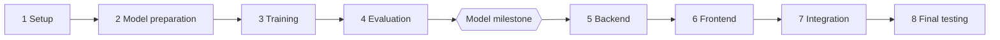

# brainX: Tasks

Do one task at a time, in order, after approval. The workflow is in [AGENTS.md](../AGENTS.md), and current status is in [PROGRESS.md](PROGRESS.md).

Check the real repo before each task, because this plan can change as we learn.

## Phase order

## Phase 1: Planning & Setup

Files marked with `*` already exist and get changed.

| ID | Task | Files | Done when |
|---|---|---|---|
| P1-T1 | Requirements and environment assessment | None | Owner confirms hardware, model path, and features |
| P1-T2 | Project documentation | `docs/`, `AGENTS.md`*, `CLAUDE.md`, `README.md`* | Docs exist and agree, and old docs are removed |
| P1-T3 | Check the Turborepo starter builds | Only what a found problem requires | Install, build, lint, and type-check run, and any error is explained |
| P1-T4 | Remove unused starter parts, with owner approval | `apps/admin`, `packages/ui`, starter READMEs, `apps/web`*, empty `models/` | Build still passes without them |
| P1-T5 | Clean up git ignores | `.gitignore`*, `.DS_Store`, `package.json`* | `model/data`, `model/checkpoints`, `model/outputs`, and other generated or private files are ignored |
| P1-T6 | Set up the Python workspace | `pyproject.toml`, `.python-version`, `uv.lock`, `model/pyproject.toml`, `model/src/__init__.py`, `model/tests/test_setup.py`, `turbo.json`*, `package.json`* | One command runs the sample pytest test |

## Phase 2: Model Preparation

Details are in [MODEL.md](MODEL.md#tasks).

| ID | Task | New packages |
|---|---|---|
| P2-T1 | Environment and hardware inspection | `torch`, `jupyterlab`, `ipykernel`, `psutil` |
| P2-T2 | Model strategy and size decision | None |
| P2-T3 | Dataset research | None |
| P2-T4 | Dataset loading | `datasets` |
| P2-T5 | Dataset exploration | `pandas`, `numpy`, `matplotlib` |
| P2-T6 | Data cleaning | `ftfy`, if needed |
| P2-T7 | Dataset splitting | None |
| P2-T8 | Tokenizer training | `regex` |
| P2-T9 | Encode, decode, and chat format | None |
| P2-T10 | Prepare token files | None |

## Phase 3: Model Training

Details are in [MODEL.md](MODEL.md#tasks). Runs that take a long time always need separate approval.

| ID | Task | New packages |
|---|---|---|
| P3-T1 | Model architecture selection | None |
| P3-T2 | Model implementation | None |
| P3-T3 | Training configuration | `pyyaml` |
| P3-T4 | Training loop | `tqdm` |
| P3-T5 | Checkpoints and failure recovery | None |
| P3-T6 | Training smoke test (needs approval to run) | None |
| P3-T7 | Fine-tuning mode | None |
| P3-T8 | Fixed test prompts | None |
| P3-T9 | Full pre-training run (needs approval to run) | None |
| P3-T10 | Fine-tuning run (needs approval to run) | None |
| P3-T11 | Checkpoint validation | None |

## Phase 4: Model Evaluation

Details are in [MODEL.md](MODEL.md#tasks).

| ID | Task | New packages |
|---|---|---|
| P4-T1 | Text generation | None |
| P4-T2 | Context handling | None |
| P4-T3 | Streaming and cancellation | None |
| P4-T4 | Evaluation | None |
| P4-T5 | Baseline comparison | None |
| P4-T6 | Inference testing | None |
| P4-T7 | Model artifact export | `safetensors`, if approved |
| P4-T8 | FastAPI integration readiness | None |

**Model milestone:** the owner confirms that the local model generates text from a prompt without any external API. Phase 5 starts only after this.

## Phase 5: Backend

Details are in [BACKEND.md](BACKEND.md#tasks).

| ID | Task | New packages |
|---|---|---|
| P5-T1 | FastAPI setup | `fastapi`, `uvicorn`, `pytest`, `httpx`, `ruff`, `mypy` |
| P5-T2 | Configuration | `pydantic-settings` |
| P5-T3 | PostgreSQL setup | None |
| P5-T4 | Async ORM | `sqlalchemy[asyncio]`, `asyncpg`, `pytest-asyncio` |
| P5-T5 | Alembic | `alembic` |
| P5-T6 | Database models | None |
| P5-T7 | API schemas and error format | None |
| P5-T8 | Conversation endpoints | None |
| P5-T9 | Message retrieval | None |
| P5-T10 | Local model integration | None |
| P5-T11 | Chat endpoint and SSE streaming | None |
| P5-T12 | Cancellation | None |
| P5-T13 | Generation settings | None |
| P5-T14 | Error handling | None |
| P5-T15 | Structured logging | `structlog` |
| P5-T16 | Security and shutdown | None |
| P5-T17 | Test coverage and boundaries | `pytest-cov` |
| P5-T18 | Performance checks | `prometheus-fastapi-instrumentator` |
| P5-T19 | Docker setup | Docker Compose |
| P5-T20 | Security scans and pre-commit | `bandit`, `pip-audit`, `pre-commit` |

## Phase 6: Frontend

Details are in [FRONTEND.md](FRONTEND.md#tasks).

| ID | Task | New packages |
|---|---|---|
| P6-T1 | Frontend environment setup | Vitest, Testing Library |
| P6-T2 | Tailwind and design tokens | Tailwind |
| P6-T3 | shadcn/ui configuration | shadcn, Radix, Lucide |
| P6-T4 | Application shell | None |
| P6-T5 | Sidebar and navigation | None |
| P6-T6 | Chat message components | None |
| P6-T7 | Prompt composer | None |
| P6-T8 | Markdown rendering | react-markdown, remark-gfm |
| P6-T9 | Code highlighting | Shiki |
| P6-T10 | Theme management | next-themes |
| P6-T11 | Streaming UI integration | Sonner |
| P6-T12 | Conversation state | TanStack Query |
| P6-T13 | Settings interface | Zustand |
| P6-T14 | Responsive design | Motion, if needed |
| P6-T15 | Accessibility | None |
| P6-T16 | UI testing and final polish | None |

## Phase 7: Integration

Phase 6 connects the UI to the backend, and this phase proves the whole product works together.

| ID | Task | Files | Done when |
|---|---|---|---|
| P7-T1 | Test the full chat with the real model | `docs/PROGRESS.md`* | Streaming, Stop, follow-ups, reload, and delete all work and are recorded |
| P7-T2 | Test every failure from the browser | `apps/web/`*, `apps/api/`* for approved fixes | Busy, no model, server down, and database down each show the right message |
| P7-T3 | Add essential Playwright tests | `apps/web/e2e/`, `apps/web/playwright.config.ts`, `apps/web/package.json`* | Send, stream, stop, and reload pass using a small test checkpoint |

## Phase 8: Final Testing

| ID | Task | Files | Done when |
|---|---|---|---|
| P8-T1 | Run all tests and fix found bugs | Files for each approved bug | Tests pass, and the bug list is resolved or recorded |
| P8-T2 | Test offline | `docs/PROGRESS.md`* | Chat works with the internet off |
| P8-T3 | Final UI review with the owner | `apps/web/`* | Owner approves the look |
| P8-T4 | Finish the README | `README.md`* | A clean clone can follow it, and results are real |
| P8-T5 | Prepare the portfolio demo | `README.md`*, `docs/` | Screenshots and a short demo script exist |
