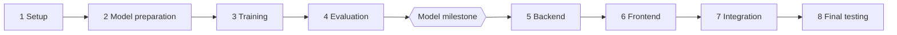

# brainX: Tasks

Do one task at a time, in order, after approval. The workflow is in [AGENTS.md](../AGENTS.md), and current status is in [PROGRESS.md](PROGRESS.md).

Check the real repo before each task, because this plan can change as we learn.

## Phase order

## Phase 1: Planning & Setup

Files marked with `*` already exist and get changed.

| ID | Task | Files | Done when |
|---|---|---|---|
| P1-T1 | Requirements and environment assessment | None | Owner confirms hardware, model path, and features |
| P1-T2 | Project documentation | `docs/`, `AGENTS.md`*, `CLAUDE.md`, `README.md`* | Docs exist and agree, and old docs are removed |
| P1-T3 | Check the Turborepo starter builds | Only what a found problem requires | Install, build, lint, and type-check run, and any error is explained |
| P1-T4 | Remove unused starter parts, with owner approval | `apps/admin`, `packages/ui`, starter READMEs, `apps/web`*, `pnpm-lock.yaml`*, empty `models/` | Build still passes without them |
| P1-T5 | Clean up git ignores | `.gitignore`*, `.DS_Store`, `.turbo/preferences/tui.json`, `package.json`* | `model/data`, `model/checkpoints`, `model/outputs`, and other generated or private files are ignored |
| P1-T6 | Set up the Python workspace | `pyproject.toml`, `.python-version`, `uv.lock`, `pnpm-workspace.yaml`*, `model/package.json`, `model/pyproject.toml`*, `model/src/__init__.py`, `model/tests/test_setup.py`, `turbo.json`*, `package.json`* | One command runs the sample pytest test |

### Details for P1-T3 to P1-T6

P1-T1 and P1-T2 are done (see [PROGRESS.md](PROGRESS.md)). Commands run from the repo root. Settings marked "tested" passed in a temporary folder on 2026-11-02, not in the real repo; each task must confirm them here.

#### P1-T3: Check the Turborepo starter builds

- **Objective:** Find out whether the committed starter installs, builds, lints, and type-checks in the real repo, before anything is built on it.
- **Prerequisites:** P1-T2.
- **Files:** None. A change is made only if the owner approves a fix for a problem found. Running the commands creates untracked generated files (`.next/`, `.turbo/`), which P1-T5 will ignore.
- **Packages:** None.
- **Steps:**
  1. Run the four Verify commands one at a time, and record the exit code and key output of each. If the Turborepo TUI (`"ui": "tui"` in `turbo.json`) hides the output, run `pnpm exec turbo run <task> --ui=stream` instead.
  2. Report the points already flagged: a temporary copy once failed with `next: command not found` (cause unknown), and `apps/admin`'s package is still named `docs`.
  3. For each failure, explain the cause in simple Bengali, or say it is unknown. Do not fix anything yet.
  4. Before proposing any change to `turbo.json` or Turborepo commands, read the docs bundled with the installed `turbo` package, as `AGENTS.md` requires.
- **Acceptance:** All four commands were run in the real repo and each result is recorded as pass or fail with real output. Every failure has a stated cause or is marked unknown. No file changed without approval.
- **Verify:** `pnpm install --frozen-lockfile`, `pnpm build`, `pnpm lint`, `pnpm check-types`
- **Learning:** What a lockfile and a frozen install are, and what Turborepo adds over running each script by hand.

#### P1-T4: Remove unused starter parts

- **Objective:** Remove starter parts the plan does not use, but only items the owner approves one by one.
- **Prerequisites:** P1-T3 gives a known baseline. The current state is committed, so every deletion can be recovered from git.
- **Files:** Candidates, each needing its own yes:
  - `apps/admin/`: **keep**. The owner decided on 2026-11-02 to keep it, with the same design system as `web`.
  - `packages/ui/`: **keep**. It is now the shared design system.
  - `apps/web/README.md`, `apps/admin/README.md`, and `packages/eslint-config/README.md` (starter text).
  - `packages/ui/src/code.tsx` and the unused starter images in each app's `public/` (nothing imports them any more).
  - `pnpm-lock.yaml`*.
  - The empty root `models/` folder. This is not `model/`.
  - **Must keep:** `packages/eslint-config/` and `packages/typescript-config/` (apart from their README), `apps/web/`, and the root `README.md`.
- **Packages:** None.
- **Steps:**
  1. List the candidates and what uses them. `@repo/ui` is referenced by `apps/admin` and `apps/web`, each in `package.json` and `app/page.tsx`.
  2. Ask the owner for a yes or no on each item, and do nothing without a yes.
  3. Check that nothing imports a file before deleting it (for example `grep -r "@repo/ui/code" apps packages --exclude-dir=node_modules`).
  4. Delete the approved items. The guard hook will ask before each deletion.
  5. Run `pnpm install` to refresh `pnpm-lock.yaml`.
  6. Run the Verify commands and compare with the P1-T3 results.
- **Acceptance:** Only approved items were removed, and nothing still imports a deleted file. Build, lint, and type-check pass as in P1-T3. `git status` shows only the approved deletions, the lockfile, and the `apps/web` edits.
- **Verify:** `pnpm install`, `pnpm build`, `pnpm lint`, `pnpm check-types`, `git status --short`
- **Learning:** How `workspace:*` dependencies link packages, and why you check what depends on something before deleting it.

#### P1-T5: Clean up git ignores

- **Objective:** Keep generated, private, and large files out of git before they exist.
- **Prerequisites:** P1-T4, so the list of tracked files is final.
- **Files:** `.gitignore`*, `.DS_Store` and `.turbo/preferences/tui.json` (both currently tracked; untrack only), `package.json`*.
- **Packages:** None.
- **Steps:**
  1. Keep the existing `node_modules` line in the root `.gitignore`, and add: `.DS_Store`, `.turbo/`, `.env`, `.env.*` with `!.env.example`, `.venv/`, `__pycache__/`, `*.pyc`, `.pytest_cache/`, `.ruff_cache/`, `.mypy_cache/`, `.ipynb_checkpoints/`, `model/data/`, `model/checkpoints/`, `model/outputs/`, and `.claude/settings.local.json`.
  2. Untrack the two tracked files with `git rm --cached`, which keeps them on disk. The guard hook will ask first.
  3. Rename the root package from `my-turborepo` to `brainx` in `package.json`. This is bundled here because the row already listed `package.json`; change nothing else in it.
  4. `apps/web/.gitignore` and `apps/admin/.gitignore` already cover `.next`, but their `.env*` line would also ignore `.env.example` (an app-level rule beats the root `!.env.example`). Add `!.env.example` right after `.env*` in both.
- **Acceptance:** `git check-ignore -v` reports a rule for each path below, and `.env.example` is not ignored. Neither tracked file is in `git ls-files`, and both still exist on disk. `pnpm build` still works after the rename.
- **Verify:** `git check-ignore -v .DS_Store .turbo/x .env model/data/x model/checkpoints/x model/outputs/x .venv/x`, then `git check-ignore -v .env.example` (should print nothing), `git ls-files | grep -E 'DS_Store|\.turbo'` (should print nothing), `test -f .DS_Store && echo still-on-disk`, `pnpm build`
- **Learning:** What `.gitignore` does and does not do. It never untracks files git already tracks, which is why `git rm --cached` is needed.

#### P1-T6: Set up the Python workspace

- **Objective:** Set up a `uv` workspace so one command runs Python tests, including through Turborepo.
- **Prerequisites:** P1-T5, so `.venv` and caches are ignored from the start.
- **Files:** As listed in the table above.
- **Packages:** `pytest` 9.2.0, as a dev dependency only. Run `/brainx-package pytest` and get approval first. `uv` 0.12.15 and a uv-managed Python 3.13.15 are already on this Mac.
- **Steps:**
  1. Read the docs bundled with the installed `turbo` package (`crafting-your-repository/configuring-tasks.mdx` and `creating-an-internal-package.mdx`) before changing `turbo.json`. Do not enable Turborepo's experimental native uv support (see [ARCHITECTURE.md](ARCHITECTURE.md#folders)).
  2. Root `pyproject.toml`: project `brainx`, `requires-python = ">=3.13,<3.14"`, `[tool.uv] package = false`, `[tool.uv.workspace] members = ["model"]`, and a dev dependency group with `pytest==9.2.0`. `apps/api` is added as a member in P5-T1.
  3. `.python-version`: `3.13`.
  4. `model/pyproject.toml` (exists, empty): project name exactly `brainx-model` (later Verify commands use `--package brainx-model`), the same Python range, the `uv_build` backend, and `module-name = "src"` with `module-root = ""`.
  5. `model/src/__init__.py` (empty). It is required: without it `uv sync` failed with "Expected a Python module at: model/src/__init__.py" in a temporary test.
  6. `model/tests/test_setup.py`: one test that imports `src`.
  7. `model/package.json`: name `@brainx/model`, private, with a `test` script that runs `cd .. && uv run --package brainx-model pytest model/tests`. Add `model` to `pnpm-workspace.yaml`.
  8. `turbo.json`: add an empty `test` task. Root `package.json`: add `"test": "turbo run test"`.
  9. Run `uv sync --all-packages` to create `uv.lock` and `.venv`, then `pnpm install` to register the new workspace package.
- **Acceptance:** All four Verify commands pass. `uv.lock` exists. The model package is named exactly `brainx-model`. No dependency other than `pytest` was added.
- **Verify:** `uv sync --all-packages`, `uv run --package brainx-model pytest model/tests`, `pnpm test`, `uv run --package brainx-model python -c "import src; print(src.__file__)"`
- **Learning:** What a uv workspace is, why a `package.json` wrapper lets Turborepo run Python tasks, and what `uv.lock` pins.

## Phase 2: Model Preparation

Details are in [MODEL.md](MODEL.md#tasks).

| ID | Task | New packages |
|---|---|---|
| P2-T1 | Environment and hardware inspection | `torch`, `jupyterlab`, `ipykernel`, `psutil` |
| P2-T2 | Model strategy and size decision | None |
| P2-T3 | Dataset research | None |
| P2-T4 | Dataset loading | `datasets` |
| P2-T5 | Dataset exploration | `pandas`, `numpy`, `matplotlib` |
| P2-T6 | Data cleaning | `ftfy`, if needed |
| P2-T7 | Dataset splitting | None |
| P2-T8 | Tokenizer training | `regex` |
| P2-T9 | Encode, decode, and chat format | None |
| P2-T10 | Prepare token files | None |

## Phase 3: Model Training

Details are in [MODEL.md](MODEL.md#tasks). Runs that take a long time always need separate approval.

| ID | Task | New packages |
|---|---|---|
| P3-T1 | Model architecture selection | None |
| P3-T2 | Model implementation | None |
| P3-T3 | Training configuration | `pyyaml` |
| P3-T4 | Training loop | `tqdm` |
| P3-T5 | Checkpoints and failure recovery | None |
| P3-T6 | Training smoke test (needs approval to run) | None |
| P3-T7 | Fine-tuning mode | None |
| P3-T8 | Fixed test prompts | None |
| P3-T9 | Full pre-training run (needs approval to run) | None |
| P3-T10 | Fine-tuning run (needs approval to run) | None |
| P3-T11 | Checkpoint validation | None |

## Phase 4: Model Evaluation

Details are in [MODEL.md](MODEL.md#tasks).

| ID | Task | New packages |
|---|---|---|
| P4-T1 | Text generation | None |
| P4-T2 | Context handling | None |
| P4-T3 | Streaming and cancellation | None |
| P4-T4 | Evaluation | None |
| P4-T5 | Baseline comparison | None |
| P4-T6 | Inference testing | None |
| P4-T7 | Model artifact export | `safetensors`, if approved |
| P4-T8 | FastAPI integration readiness | None |

**Model milestone:** the owner confirms that the local model generates text from a prompt without any external API. Phase 5 starts only after this.

## Phase 5: Backend

Details are in [BACKEND.md](BACKEND.md#tasks).

| ID | Task | New packages |
|---|---|---|
| P5-T1 | FastAPI setup | `fastapi`, `uvicorn`, `httpx`, `ruff`, `mypy` (`pytest` is already installed in P1-T6) |
| P5-T2 | Configuration | `pydantic-settings` |
| P5-T3 | PostgreSQL setup | None |
| P5-T4 | Async ORM | `sqlalchemy[asyncio]`, `asyncpg`, `pytest-asyncio` |
| P5-T5 | Alembic | `alembic` |
| P5-T6 | User, conversation, and message models | None |
| P5-T6A | Account authentication and authorization | Authentication packages after approved review |
| P5-T7 | API schemas and error format | None |
| P5-T8 | Conversation endpoints | None |
| P5-T9 | Message retrieval | None |
| P5-T10 | Local model integration | None |
| P5-T11 | Chat endpoint and SSE streaming | None |
| P5-T12 | Cancellation | None |
| P5-T13 | Generation settings | None |
| P5-T14 | Error handling | None |
| P5-T15 | Structured logging | `structlog` |
| P5-T16 | Security and shutdown | None |
| P5-T17 | Test coverage and boundaries | `pytest-cov` |
| P5-T18 | Performance checks | `prometheus-fastapi-instrumentator` |
| P5-T19 | Docker setup | Docker Compose |
| P5-T20 | Security scans and pre-commit | `bandit`, `pip-audit`, `pre-commit` |

## Phase 6: Frontend

Details are in [FRONTEND.md](FRONTEND.md#tasks).

| ID | Task | New packages |
|---|---|---|
| P6-T1 | Frontend environment setup | Vitest, Testing Library |
| P6-T2 | Tailwind and design tokens | Tailwind |
| P6-T3 | shadcn/ui configuration | shadcn, Radix, Lucide |
| P6-T4 | Application shell | None |
| P6-T4A | Authentication pages and protected chat routes | None unless a reviewed need appears |
| P6-T5 | Sidebar and navigation | None |
| P6-T6 | Chat message components | None |
| P6-T7 | Prompt composer | None |
| P6-T8 | Markdown rendering | react-markdown, remark-gfm |
| P6-T9 | Code highlighting | Shiki |
| P6-T10 | Theme management | next-themes |
| P6-T11 | Streaming UI integration | Sonner |
| P6-T12 | Conversation state | TanStack Query |
| P6-T13 | Settings interface | Zustand |
| P6-T14 | Responsive design | Motion, if needed |
| P6-T15 | Accessibility | None |
| P6-T16 | UI testing and final polish | None |

## Phase 7: Integration

Phase 6 connects the UI to the backend, and this phase proves the whole product works together.

| ID | Task | Files | Done when |
|---|---|---|---|
| P7-T1 | Test the full chat with the real model | `docs/PROGRESS.md`* | Streaming, Stop, follow-ups, reload, and delete all work and are recorded |
| P7-T2 | Test every failure from the browser | `apps/web/`*, `apps/api/`* for approved fixes | Busy, no model, server down, and database down each show the right message |
| P7-T3 | Add essential Playwright tests | `apps/web/e2e/`, `apps/web/playwright.config.ts`, `apps/web/package.json`* | Send, stream, stop, and reload pass using a small test checkpoint |
| P7-T4 | Test accounts and data isolation | `docs/PROGRESS.md`* | Register, login, logout, protected routes, and cross-user conversation denial are recorded |

### Details for P7-T1 to P7-T4

Phase 6 connects the UI to the backend. These tasks prove the whole product works together. Use the dev scripts created in P5-T1 and P6-T1, and confirm the exact commands in the repo before running them.

#### P7-T1: Test the full chat with the real model

- **Objective:** Check the whole product end to end with the real trained model, and record what happens.
- **Prerequisites:** P6-T16.
- **Files:** `docs/PROGRESS.md`* only.
- **Packages:** None.
- **Steps:**
  1. Start PostgreSQL, apply the migrations, set `BRAINX_CHECKPOINT` to the exported model folder, and start the API and the web app.
  2. In the browser, walk through this script and write down what you actually see at each step: create a new chat; send a message and watch it stream; press Stop mid-reply and check the partial text stays; send a follow-up and check it uses the earlier message; reload and check the history is still there; restart the API and check again; delete a conversation; change a generation setting and check it reaches the API.
  3. Record time to first token and tokens per second from `/metrics` or the logs, as measured values.
  4. Note every bug or surprise. Do not fix anything in this task.
- **Acceptance:** Every step of the script has a recorded result (works, fails, or odd) written from what was seen. Any number comes from real output.
- **Verify:** `curl http://127.0.0.1:8000/api/v1/ready`, the browser script above, then `uv run --package brainx-api pytest apps/api/tests` and `pnpm test`
- **Learning:** How the parts behave when they run together, and why a written test script finds problems that unit tests miss.

#### P7-T2: Test every failure from the browser

- **Objective:** Check that each documented failure shows the right message and leaves the app usable.
- **Prerequisites:** P7-T1.
- **Files:** `docs/PROGRESS.md`*. `apps/web/`* and `apps/api/`* only for fixes the owner approves.
- **Packages:** None.
- **Steps:** Cause each failure below, read what the UI shows, and compare it with [BACKEND.md](BACKEND.md#errors) and [DESIGN.md](DESIGN.md):
  1. Busy: send a message from a second browser tab while a reply is generating.
  2. No model: start the API without `BRAINX_CHECKPOINT`.
  3. API down: stop the API, then start it again.
  4. Database down: stop PostgreSQL, then start it again.
  5. Settings out of range: check that the UI never lets you send them.
  6. Blocked storage: block site data for `localhost`, and check that chat still works with default settings.
  7. Delete a chat while its reply is generating.
- **Acceptance:** Each case shows the documented message and the app stays usable. After the problem is fixed, the next message works, so the model was released. Every failure found is listed; a fix is made only with approval and a new test.
- **Verify:** The cases above, then `uv run --package brainx-api pytest apps/api/tests` and `pnpm test`
- **Learning:** Why error paths need testing as much as the normal path.

#### P7-T3: Add essential Playwright tests

- **Objective:** Automate the most important browser flow.
- **Prerequisites:** P7-T2.
- **Files:** `apps/web/e2e/`, `apps/web/playwright.config.ts`, `apps/web/package.json`*, `pnpm-lock.yaml`*.
- **Packages:** `@playwright/test` 1.64.1, with approval via `/brainx-package`. Playwright also downloads a browser, which needs its own approval and network access.
- **Steps:**
  1. Add the package, then download one browser (Chromium) with Playwright's own install command.
  2. Write a script that creates a tiny, randomly initialised model artifact from the model code, so the tests need no real training. Keep it under `model/outputs/`, out of git.
  3. Configure Playwright to start the API (with that artifact and the `brainx_test` database) and the web app.
  4. Write tests for: send a message and see streamed text; stop a reply and keep the partial text; reload and see the history; delete a conversation. Add a `test:e2e` script.
- **Acceptance:** The tests pass three runs in a row, and they use only the tiny model and the test database, never your real data.
- **Verify:** `pnpm --filter web test:e2e`
- **Learning:** What an end-to-end test covers that component tests cannot, and why the tests use a tiny model.

#### P7-T4: Test accounts and data isolation

- **Objective:** Prove that public account access works and that one user cannot access another user's chats.
- **Prerequisites:** P7-T3.
- **Files:** `docs/PROGRESS.md`* only. `apps/web/` and `apps/api/` change only for a separately approved bug fix.
- **Packages:** None.
- **Steps:** In two fresh browser sessions, register two test users; log in and out; try opening, listing, sending to, and deleting the other user's conversation ID; then confirm the normal user can still chat after the failed attempts. Record the exact status and UI result for each case.
- **Acceptance:** Registration, login, logout, protected-route redirect, and each cross-user attempt have real recorded results. Cross-user requests reveal neither content nor existence. Any bug is listed and fixed only with approval.
- **Verify:** `uv run --package brainx-api pytest apps/api/tests/test_auth.py`, `pnpm --filter web test:e2e`, and the two-session browser script above.
- **Learning:** Why authentication alone is not enough without authorization on every data query.

## Phase 8: Final Testing

| ID | Task | Files | Done when |
|---|---|---|---|
| P8-T1 | Run all tests and fix found bugs | Files for each approved bug | Tests pass, and the bug list is resolved or recorded |
| P8-T2 | Test offline | `docs/PROGRESS.md`* | Chat works with the internet off |
| P8-T3 | Final UI review with the owner | `apps/web/`* | Owner approves the look |
| P8-T4 | Finish the README | `README.md`* | A clean clone can follow it, and results are real |
| P8-T5 | Prepare the portfolio demo | `README.md`*, `docs/` | Screenshots and a short demo script exist |
| P8-T6 | Deploy the public portfolio app | Deployment configuration and `docs/PROGRESS.md`* | The HTTPS live URL, health check, account flow, chat, limits, and rollback steps are verified |

### Details for P8-T1 to P8-T6

#### P8-T1: Run all tests and fix found bugs

- **Objective:** Make every check pass, and deal with the bugs found in Phase 7.
- **Prerequisites:** P7-T3.
- **Files:** `docs/PROGRESS.md`*. Other files only for bugs the owner approves.
- **Packages:** None.
- **Steps:**
  1. Run every check in Verify, and list each failure together with the Phase 7 bugs in a table: symptom, cause, proposed fix.
  2. The owner picks which to fix.
  3. Fix one at a time, each with a test that failed before and passes after.
  4. Run all checks again.
- **Acceptance:** All checks pass, or each remaining failure is listed with its reason and the owner's decision. Nothing outside the approved bugs changed.
- **Verify:** `pnpm lint`, `pnpm check-types`, `pnpm build`, `pnpm test`, `uv run --package brainx-model pytest model/tests`, `uv run --package brainx-api pytest apps/api/tests`, `pnpm --filter web test:e2e`
- **Learning:** How to triage bugs, and why a fix needs a test that failed first.

#### P8-T2: Test offline

- **Objective:** Show that the app works with no internet.
- **Prerequisites:** P8-T1.
- **Files:** `docs/PROGRESS.md`*.
- **Packages:** None.
- **Steps:**
  1. With everything installed and the model exported, turn Wi-Fi off.
  2. Start PostgreSQL, the API, and the web app, then run the P7-T1 script.
  3. In the browser's Network tab, check that every request goes to `localhost`, and list any that tries to reach the internet (fonts, scripts, images).
  4. Turn Wi-Fi back on.
- **Acceptance:** The whole script works offline, and the Network tab shows only local requests. Any outside request is listed, and fixed only with approval.
- **Verify:** `curl http://127.0.0.1:8000/api/v1/ready` with the network off, then the browser script
- **Learning:** What local-first means in practice, and how to inspect network requests.

#### P8-T3: Final UI review

- **Objective:** The owner reviews the finished UI against [DESIGN.md](DESIGN.md) and decides what to change.
- **Prerequisites:** P8-T2.
- **Files:** `apps/web/`* only for changes the owner approves.
- **Packages:** None.
- **Steps:**
  1. Open the app at 375px, 768px, and 1280px, in light and dark.
  2. Check it against DESIGN.md: colours, type, borders, every component state, keyboard shortcuts, focus outline, and reduced motion.
  3. The owner lists the changes wanted.
  4. Make only those, one at a time.
- **Acceptance:** The owner says they approve the look, and each change traces to their list.
- **Verify:** `pnpm lint`, `pnpm check-types`, `pnpm test`, `pnpm build`, then the manual review
- **Learning:** How to review a UI against written rules instead of by feeling.

#### P8-T4: Finish the README

- **Objective:** Someone new can set up and run the project from the README alone.
- **Prerequisites:** P8-T3.
- **Files:** `README.md`*.
- **Packages:** None.
- **Steps:**
  1. Write these sections: what it is, requirements with versions, setup, how to prepare data and train, how to run, results with limits, an architecture diagram, and troubleshooting.
  2. Copy every command from one that was actually run. Take every number from a run folder.
  3. Clone the repo into a new empty folder and follow only the README.
- **Acceptance:** The clean-clone run works, or the README is fixed until it does. Every number traces to a run folder or real command output.
- **Verify:** `git clone <this repo> <new empty folder>`, then follow the README step by step
- **Learning:** Why writing for a stranger finds the steps you forgot.

#### P8-T5: Prepare the portfolio demo

- **Objective:** Make the project easy to present.
- **Prerequisites:** P8-T4.
- **Files:** `README.md`*, `docs/DEMO.md`.
- **Packages:** None.
- **Steps:**
  1. Take screenshots of the real app: light, dark, and mobile.
  2. Write a 60 to 90 second demo script in `docs/DEMO.md`.
  3. Add a model card to the README: size, data and licences, training time, results, and limits.
  4. Add a short "what I learned" section in the owner's own words.
- **Acceptance:** The files exist, the screenshots show the real app, every number traces to a run folder, and the limits are stated honestly.
- **Verify:** Open each file, and trace each number to its source
- **Learning:** How to present a project honestly, including what it cannot do.

#### P8-T6: Deploy the public portfolio app

- **Objective:** Publish the finished portfolio app safely, with an honest record of its limits and a way to recover from a failed release.
- **Prerequisites:** P8-T5 and the owner's explicit approval of the selected hosting provider, expected cost, production domain, and secrets plan.
- **Files:** Only deployment configuration and `docs/PROGRESS.md`*, chosen after the provider decision. Do not create cloud resources or send data to a provider before that approval.
- **Packages:** None by default. Any provider SDK, deployment CLI, or monitoring package needs its own package review and approval.
- **Steps:** Use P4-T6 and P5-T18 measurements to choose a host that fits the model's real CPU memory and latency needs; configure separate production secrets; enable HTTPS; set the exact web origin and secure session-cookie settings; apply migrations; deploy; test the health endpoint, account flow, and one chat; document the live URL, a resource limit, expected limitations, and rollback command.
- **Acceptance:** The public URL uses HTTPS; login, ownership checks, and chat work; secrets are absent from git and browser storage; local development still works; and the documentation contains only measured performance and real deployment details.
- **Verify:** Visit the HTTPS URL in a private browser window, complete the P7-T1 and P7-T4 scripts, inspect browser storage, run the deployed health check, and follow the documented rollback procedure without executing it.
- **Learning:** Why production is a separate environment, and why deployment starts with measured model requirements rather than a favourite host.

## Setup work outside the numbered tasks

This work was done before Phase 1 so the agent can follow the workflow in [AGENTS.md](../AGENTS.md).

| Item | Where | Status |
|---|---|---|
| Seven skills (`/brainx-task`, `-verify`, `-walkthrough`, `-teach`, `-progress`, `-package`, `-train`) | `.claude/skills/` | Written and committed; not yet run in Claude Code |
| Two read-only subagents (`scope-reviewer`, `doc-auditor`) | `.claude/agents/` | Written and committed; not yet run |
| Guard hook for risky commands | `.claude/hooks/brainx_guard.py`, `.claude/settings.json` | Script passed 103 sample commands alone; did not fire in the session that created it |
| Student guide | [GUIDE.md](GUIDE.md) | Written |
| Shared design system (`packages/ui`): tokens, 10 components, theme toggle, toasts | `packages/ui/src/` | Built early at the owner's request; types, lint, and build pass; screenshots checked; clicks not tested. See [FRONTEND.md](FRONTEND.md#ui-foundation-done-early-2026-11-02) |
| Web chat preview and Admin pages (Overview, Design system) using that system | `apps/web/`, `apps/admin/` | Built; static, not connected to any model or API |
| Turborepo helpers: `pnpm boundaries` check and the `turbo gen component` generator | `package.json`, `packages/ui/turbo/generators/` | Both ran successfully once; the generator's sample file was deleted |
