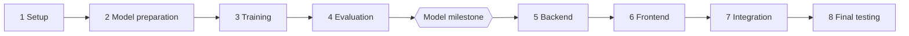

# brainX: Tasks

Do one task at a time, in order, after approval. The workflow is in [AGENTS.md](../AGENTS.md), and current status is in [PROGRESS.md](PROGRESS.md).

Check the real repo before each task, because this plan can change as we learn.

## Phase order

## Phase 1: Planning & Setup

Files marked with `*` already exist and get changed.

| ID | Task | Files | Done when |
|---|---|---|---|
| P1-T1 | Requirements and environment assessment | None | Owner confirms hardware, model path, and features |
| P1-T2 | Project documentation | `docs/`, `AGENTS.md`*, `CLAUDE.md`, `README.md`* | Docs exist and agree, and old docs are removed |
| P1-T3 | Check the Turborepo starter builds | Only what a found problem requires | Install, build, lint, and type-check run, and any error is explained |
| P1-T4 | Remove unused starter parts, with owner approval | `apps/admin`, `packages/ui`, starter READMEs, `apps/web`*, `pnpm-lock.yaml`*, empty `models/` | Build still passes without them |
| P1-T5 | Clean up git ignores | `.gitignore`*, `.DS_Store`, `.turbo/preferences/tui.json`, `package.json`* | `model/data`, `model/checkpoints`, `model/outputs`, and other generated or private files are ignored |
| P1-T6 | Set up the Python workspace | `pyproject.toml`, `.python-version`, `uv.lock`, `pnpm-workspace.yaml`*, `model/package.json`, `model/pyproject.toml`*, `model/src/__init__.py`, `model/tests/test_setup.py`, `turbo.json`*, `package.json`* | One command runs the sample pytest test |

### Details for P1-T3 to P1-T6

P1-T1 and P1-T2 are done (see [PROGRESS.md](PROGRESS.md)). Commands run from the repo root. Settings marked "tested" passed in a temporary folder on 2026-11-02, not in the real repo; each task must confirm them here.

#### P1-T3: Check the Turborepo starter builds

- **Objective:** Find out whether the committed starter installs, builds, lints, and type-checks in the real repo, before anything is built on it.
- **Prerequisites:** P1-T2.
- **Files:** None. A change is made only if the owner approves a fix for a problem found. Running the commands creates untracked generated files (`.next/`, `.turbo/`), which P1-T5 will ignore.
- **Packages:** None.
- **Steps:**
  1. Run the four Verify commands one at a time, and record the exit code and key output of each. If the Turborepo TUI (`"ui": "tui"` in `turbo.json`) hides the output, run `pnpm exec turbo run <task> --ui=stream` instead.
  2. Report the points already flagged: a temporary copy once failed with `next: command not found` (cause unknown), and `apps/admin`'s package is still named `docs`.
  3. For each failure, explain the cause in simple Bengali, or say it is unknown. Do not fix anything yet.
  4. Before proposing any change to `turbo.json` or Turborepo commands, read the docs bundled with the installed `turbo` package, as `AGENTS.md` requires.
- **Acceptance:** All four commands were run in the real repo and each result is recorded as pass or fail with real output. Every failure has a stated cause or is marked unknown. No file changed without approval.
- **Verify:** `pnpm install --frozen-lockfile`, `pnpm build`, `pnpm lint`, `pnpm check-types`
- **Learning:** What a lockfile and a frozen install are, and what Turborepo adds over running each script by hand.

#### P1-T4: Remove unused starter parts

- **Objective:** Remove starter parts the plan does not use, but only items the owner approves one by one.
- **Prerequisites:** P1-T3 gives a known baseline. The current state is committed, so every deletion can be recovered from git.
- **Files:** Candidates, each needing its own yes:
  - `apps/admin/` (the renamed starter docs app; the owner may keep it).
  - `packages/ui/` (used only by the two apps).
  - `apps/web/README.md`, `apps/admin/README.md`, and `packages/eslint-config/README.md` (starter text).
  - `apps/web/app/page.tsx`* and `apps/web/package.json`* (stop using `@repo/ui`).
  - `pnpm-lock.yaml`*.
  - The empty root `models/` folder. This is not `model/`.
  - **Must keep:** `packages/eslint-config/` and `packages/typescript-config/` (apart from their README), `apps/web/`, and the root `README.md`.
- **Packages:** None.
- **Steps:**
  1. List the candidates and what uses them. `@repo/ui` is referenced by `apps/admin` and `apps/web`, each in `package.json` and `app/page.tsx`.
  2. Ask the owner for a yes or no on each item, and do nothing without a yes.
  3. If `packages/ui` is removed, first stop importing it in `apps/web` (and `apps/admin` if kept), and remove the dependency from their `package.json`.
  4. Delete the approved items. The guard hook will ask before each deletion.
  5. Run `pnpm install` to refresh `pnpm-lock.yaml`.
  6. Run the Verify commands and compare with the P1-T3 results.
- **Acceptance:** Only approved items were removed. If `packages/ui` is gone, `grep -r "@repo/ui" apps packages --exclude-dir=node_modules` finds nothing. Build, lint, and type-check pass as in P1-T3. `git status` shows only the approved deletions, the lockfile, and the `apps/web` edits.
- **Verify:** `pnpm install`, `pnpm build`, `pnpm lint`, `pnpm check-types`, `git status --short`
- **Learning:** How `workspace:*` dependencies link packages, and why you check what depends on something before deleting it.

#### P1-T5: Clean up git ignores

- **Objective:** Keep generated, private, and large files out of git before they exist.
- **Prerequisites:** P1-T4, so the list of tracked files is final.
- **Files:** `.gitignore`*, `.DS_Store` and `.turbo/preferences/tui.json` (both currently tracked; untrack only), `package.json`*.
- **Packages:** None.
- **Steps:**
  1. Keep the existing `node_modules` line in the root `.gitignore`, and add: `.DS_Store`, `.turbo/`, `.env`, `.env.*` with `!.env.example`, `.venv/`, `__pycache__/`, `*.pyc`, `.pytest_cache/`, `.ruff_cache/`, `.mypy_cache/`, `.ipynb_checkpoints/`, `model/data/`, `model/checkpoints/`, `model/outputs/`, and `.claude/settings.local.json`.
  2. Untrack the two tracked files with `git rm --cached`, which keeps them on disk. The guard hook will ask first.
  3. Rename the root package from `my-turborepo` to `brainx` in `package.json`. This is bundled here because the row already listed `package.json`; change nothing else in it.
  4. `apps/web/.gitignore` already covers `.next` and `.env*`; leave it alone.
- **Acceptance:** `git check-ignore -v` reports a rule for each path below, and `.env.example` is not ignored. Neither tracked file is in `git ls-files`, and both still exist on disk. `pnpm build` still works after the rename.
- **Verify:** `git check-ignore -v .DS_Store .turbo/x .env model/data/x model/checkpoints/x model/outputs/x .venv/x`, then `git check-ignore -v .env.example` (should print nothing), `git ls-files | grep -E 'DS_Store|\.turbo'` (should print nothing), `test -f .DS_Store && echo still-on-disk`, `pnpm build`
- **Learning:** What `.gitignore` does and does not do. It never untracks files git already tracks, which is why `git rm --cached` is needed.

#### P1-T6: Set up the Python workspace

- **Objective:** Set up a `uv` workspace so one command runs Python tests, including through Turborepo.
- **Prerequisites:** P1-T5, so `.venv` and caches are ignored from the start.
- **Files:** As listed in the table above.
- **Packages:** `pytest` 9.2.0, as a dev dependency only. Run `/brainx-package pytest` and get approval first. `uv` 0.12.15 and a uv-managed Python 3.13.15 are already on this Mac.
- **Steps:**
  1. Read the docs bundled with the installed `turbo` package (`crafting-your-repository/configuring-tasks.mdx` and `creating-an-internal-package.mdx`) before changing `turbo.json`. Do not enable Turborepo's experimental native uv support (see [ARCHITECTURE.md](ARCHITECTURE.md#folders)).
  2. Root `pyproject.toml`: project `brainx`, `requires-python = ">=3.13,<3.14"`, `[tool.uv] package = false`, `[tool.uv.workspace] members = ["model"]`, and a dev dependency group with `pytest==9.2.0`. `apps/api` is added as a member in P5-T1.
  3. `.python-version`: `3.13`.
  4. `model/pyproject.toml` (exists, empty): project name exactly `brainx-model` (later Verify commands use `--package brainx-model`), the same Python range, the `uv_build` backend, and `module-name = "src"` with `module-root = ""`.
  5. `model/src/__init__.py` (empty). It is required: without it `uv sync` failed with "Expected a Python module at: model/src/__init__.py" in a temporary test.
  6. `model/tests/test_setup.py`: one test that imports `src`.
  7. `model/package.json`: name `@brainx/model`, private, with a `test` script that runs `cd .. && uv run --package brainx-model pytest model/tests`. Add `model` to `pnpm-workspace.yaml`.
  8. `turbo.json`: add an empty `test` task. Root `package.json`: add `"test": "turbo run test"`.
  9. Run `uv sync --all-packages` to create `uv.lock` and `.venv`, then `pnpm install` to register the new workspace package.
- **Acceptance:** All four Verify commands pass. `uv.lock` exists. The model package is named exactly `brainx-model`. No dependency other than `pytest` was added.
- **Verify:** `uv sync --all-packages`, `uv run --package brainx-model pytest model/tests`, `pnpm test`, `uv run --package brainx-model python -c "import src; print(src.__file__)"`
- **Learning:** What a uv workspace is, why a `package.json` wrapper lets Turborepo run Python tasks, and what `uv.lock` pins.

## Phase 2: Model Preparation

Details are in [MODEL.md](MODEL.md#tasks).

| ID | Task | New packages |
|---|---|---|
| P2-T1 | Environment and hardware inspection | `torch`, `jupyterlab`, `ipykernel`, `psutil` |
| P2-T2 | Model strategy and size decision | None |
| P2-T3 | Dataset research | None |
| P2-T4 | Dataset loading | `datasets` |
| P2-T5 | Dataset exploration | `pandas`, `numpy`, `matplotlib` |
| P2-T6 | Data cleaning | `ftfy`, if needed |
| P2-T7 | Dataset splitting | None |
| P2-T8 | Tokenizer training | `regex` |
| P2-T9 | Encode, decode, and chat format | None |
| P2-T10 | Prepare token files | None |

## Phase 3: Model Training

Details are in [MODEL.md](MODEL.md#tasks). Runs that take a long time always need separate approval.

| ID | Task | New packages |
|---|---|---|
| P3-T1 | Model architecture selection | None |
| P3-T2 | Model implementation | None |
| P3-T3 | Training configuration | `pyyaml` |
| P3-T4 | Training loop | `tqdm` |
| P3-T5 | Checkpoints and failure recovery | None |
| P3-T6 | Training smoke test (needs approval to run) | None |
| P3-T7 | Fine-tuning mode | None |
| P3-T8 | Fixed test prompts | None |
| P3-T9 | Full pre-training run (needs approval to run) | None |
| P3-T10 | Fine-tuning run (needs approval to run) | None |
| P3-T11 | Checkpoint validation | None |

## Phase 4: Model Evaluation

Details are in [MODEL.md](MODEL.md#tasks).

| ID | Task | New packages |
|---|---|---|
| P4-T1 | Text generation | None |
| P4-T2 | Context handling | None |
| P4-T3 | Streaming and cancellation | None |
| P4-T4 | Evaluation | None |
| P4-T5 | Baseline comparison | None |
| P4-T6 | Inference testing | None |
| P4-T7 | Model artifact export | `safetensors`, if approved |
| P4-T8 | FastAPI integration readiness | None |

**Model milestone:** the owner confirms that the local model generates text from a prompt without any external API. Phase 5 starts only after this.

## Phase 5: Backend

Details are in [BACKEND.md](BACKEND.md#tasks).

| ID | Task | New packages |
|---|---|---|
| P5-T1 | FastAPI setup | `fastapi`, `uvicorn`, `pytest`, `httpx`, `ruff`, `mypy` |
| P5-T2 | Configuration | `pydantic-settings` |
| P5-T3 | PostgreSQL setup | None |
| P5-T4 | Async ORM | `sqlalchemy[asyncio]`, `asyncpg`, `pytest-asyncio` |
| P5-T5 | Alembic | `alembic` |
| P5-T6 | Database models | None |
| P5-T7 | API schemas and error format | None |
| P5-T8 | Conversation endpoints | None |
| P5-T9 | Message retrieval | None |
| P5-T10 | Local model integration | None |
| P5-T11 | Chat endpoint and SSE streaming | None |
| P5-T12 | Cancellation | None |
| P5-T13 | Generation settings | None |
| P5-T14 | Error handling | None |
| P5-T15 | Structured logging | `structlog` |
| P5-T16 | Security and shutdown | None |
| P5-T17 | Test coverage and boundaries | `pytest-cov` |
| P5-T18 | Performance checks | `prometheus-fastapi-instrumentator` |
| P5-T19 | Docker setup | Docker Compose |
| P5-T20 | Security scans and pre-commit | `bandit`, `pip-audit`, `pre-commit` |

## Phase 6: Frontend

Details are in [FRONTEND.md](FRONTEND.md#tasks).

| ID | Task | New packages |
|---|---|---|
| P6-T1 | Frontend environment setup | Vitest, Testing Library |
| P6-T2 | Tailwind and design tokens | Tailwind |
| P6-T3 | shadcn/ui configuration | shadcn, Radix, Lucide |
| P6-T4 | Application shell | None |
| P6-T5 | Sidebar and navigation | None |
| P6-T6 | Chat message components | None |
| P6-T7 | Prompt composer | None |
| P6-T8 | Markdown rendering | react-markdown, remark-gfm |
| P6-T9 | Code highlighting | Shiki |
| P6-T10 | Theme management | next-themes |
| P6-T11 | Streaming UI integration | Sonner |
| P6-T12 | Conversation state | TanStack Query |
| P6-T13 | Settings interface | Zustand |
| P6-T14 | Responsive design | Motion, if needed |
| P6-T15 | Accessibility | None |
| P6-T16 | UI testing and final polish | None |

## Phase 7: Integration

Phase 6 connects the UI to the backend, and this phase proves the whole product works together.

| ID | Task | Files | Done when |
|---|---|---|---|
| P7-T1 | Test the full chat with the real model | `docs/PROGRESS.md`* | Streaming, Stop, follow-ups, reload, and delete all work and are recorded |
| P7-T2 | Test every failure from the browser | `apps/web/`*, `apps/api/`* for approved fixes | Busy, no model, server down, and database down each show the right message |
| P7-T3 | Add essential Playwright tests | `apps/web/e2e/`, `apps/web/playwright.config.ts`, `apps/web/package.json`* | Send, stream, stop, and reload pass using a small test checkpoint |

## Phase 8: Final Testing

| ID | Task | Files | Done when |
|---|---|---|---|
| P8-T1 | Run all tests and fix found bugs | Files for each approved bug | Tests pass, and the bug list is resolved or recorded |
| P8-T2 | Test offline | `docs/PROGRESS.md`* | Chat works with the internet off |
| P8-T3 | Final UI review with the owner | `apps/web/`* | Owner approves the look |
| P8-T4 | Finish the README | `README.md`* | A clean clone can follow it, and results are real |
| P8-T5 | Prepare the portfolio demo | `README.md`*, `docs/` | Screenshots and a short demo script exist |
